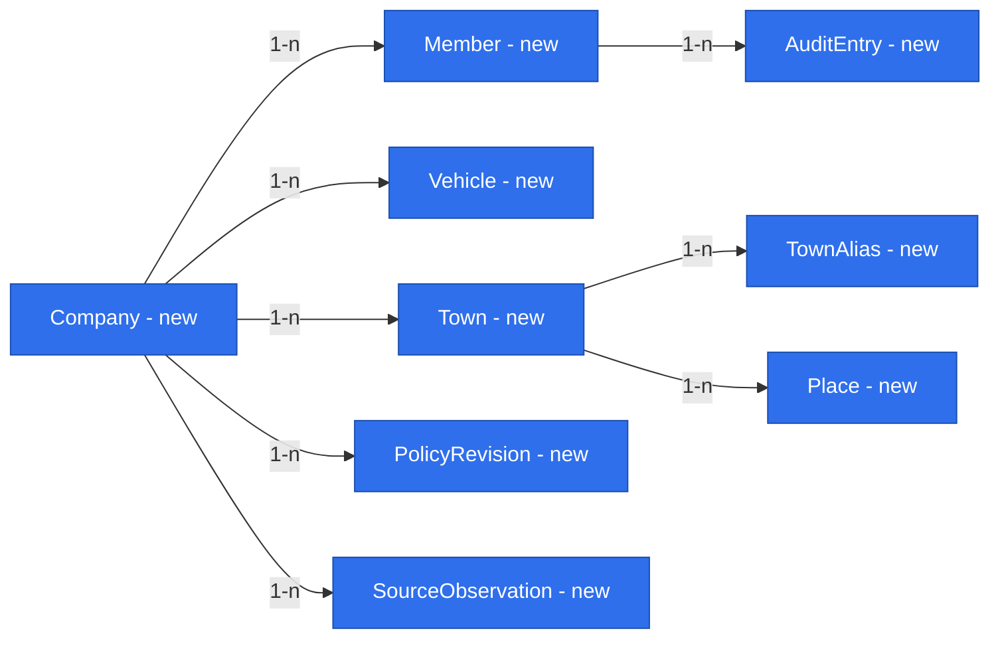

# E01 foundations — exact values, evidence, providers and access

Status: **approved by the owner on 2026-10-27; not implemented**. Date: 2026-10-26.
Companion: [E01 feature](2026-10-26-e01-trip-entry-and-quotation.md). Scope: #18/#22–#26/#28 (D33). Binding: [product brief](product-brief.md) R02–R20 and active D16–D65.

## 📝 TLDR

E01 needs exact financial calculation, dated source evidence, reliable place identity and secure company access. This document defines those shared contracts once; the feature specification defines behaviour, phases and tests and refers to the rule IDs below (`FIN-*`, `EV-*`, `SRC-*`, `ROUTE-*`, `PLACE-*`, `AUTH-*`, `TIME-*`, `RUN-*`). Each primitive ships with its first consuming phase; there is no foundation-only release.

Owner policy is settled. Remaining readiness work is technical: verifying the authentication library (AUTH-2), the HERE account/terms check, the Phase 1 environment (#35), the hourly source copy (#36) and the owner entering threshold values.

## 📝 References

Primary sources checked 2026-10-26; they support design choices, not provider readiness:

- [decimal.js](https://mikemcl.github.io/decimal.js/) — precision and rounding modes (FIN-2).
- [NBP API](https://api.nbp.pl/en.html) — dated tables, no data on non-publication days (SRC-2).
- [HERE Routing v8](https://www.here.com/docs/bundle/routing-api-developer-guide-v8/page/README.html) and [HERE Geocoding & Search](https://www.here.com/docs/bundle/geocoding-and-search-api-v7-api-reference/page/index.html) — truck profile, per-country spans, tolls, place lookup (ROUTE-1).
- [Better Auth email/password](https://better-auth.com/docs/authentication/email-password) — example of a maintained library with hashing, reset and sessions (AUTH-2).
- [MikroORM transactions](https://mikro-orm.io/docs/transactions) — version checks and transactions (TIME-3).

## 📝 Architecture and Reuse

Dependency direction: app/server → core (contracts, pure calculation) and db (adapters); app → ui; db → core contracts where needed. Core never imports app, db, ui, Next.js, Awilix or MikroORM. UI receives structural props, parsers and translated labels, never repositories or ORM objects. Identifiers below are proposed contracts; add public exports only with their first implementation and preserve protected helpers listed in [backward compatibility](../../BACKWARD_COMPATIBILITY.md).

Existing code reused as is:

- `decimalStringSchema` — lexical transport of decimals (FIN-1).
- `makeCrudRoute` — plain reference records only: vehicles, places, policy revisions (create/read only) and read-only trip lists. Its current signature has no list filters or expected-version input; E01 does not change it.
- `apiHandler` — every business command and every non-CRUD read.
- `apiCall` — every browser API call.
- `CrudForm` — flat text forms (vehicle, place, policy revision, member invitation). Decimals stay text with `inputMode: "decimal"`. The trip entry and quote panel are page composition, not a `CrudForm` extension (feature, UI).
- `DataTable` and the feedback components — lists and states.
- `RequestScope {tenantId, actorId}` and the per-request forked EntityManager.

| Primitive | First phase | Later reuse |
|---|---|---|
| P01 Exact values | 1 | E3, E7 |
| P02 Value evidence | 1 | E3, E7 |
| P03 Dated inputs and routing | 1 | E3/E4 |
| P04 Place identity | 1 | #28, E10a |
| P05 Scoped access | 1 | all modules |
| P06 Authentication | 1 | all modules |
| P07 Timed segments | 1 | #24, E7 |
| P08 Revision commands | 1 | E3, E11a |
| P09 Import identity | 3 | E4, E10a |
| P10 Clock and configuration | 1 | all modules |

This is the only primitive table; the feature specification refers to it.

## 📝 P01 — Exact values and rounding

- **FIN-1 Transport.** Money and fuel never pass through JavaScript `number`. DTOs carry `decimalStringSchema` strings; feature schemas add unit, currency, sign and scale. Polish decimal entry (comma) is normalized as text before validation. Positive and negative zero display as zero; a known zero stays known.
- **FIN-2 Arithmetic.** Core uses one `Decimal.clone({ precision: 50, rounding: Decimal.ROUND_HALF_UP })` instance for all financial formulas. Components are never rounded; only published values are. Rationale: the only non-terminating quotients are FX conversion, `elapsedSeconds / 86400` and the litre-weighted fuel price. A non-terminating quotient can never equal a tie, and with validated operand bounds its distance from any tie is far larger than the error of 50 significant digits. Validate input magnitude/scale bounds (FIN-4) so this argument holds.
- **FIN-3 Publication (R11).** EUR net money totals at scale 2; unit prices, FX rates and consumption at 6; kilometres and litres at 3. Ties half-up, negative ties away from zero (`toDecimalPlaces(n, ROUND_HALF_UP)`). Round each published aggregate once from exact values; never sum rounded components into a total. When displayed components differ from the published aggregate, show a rounding reconciliation line. Comparisons, the loss-reason check and sorting use the published rounded result. There is no verdict engine. The owner approved these scales and the rounding rule on 2026-10-27.
- **FIN-4 Storage.** Published values use `numeric(30,2)`, `numeric(30,6)` and `numeric(30,3)`. Source inputs use unconstrained `numeric`, which keeps any scale exactly, plus unit and currency. Inputs are bounded (magnitude and scale) before writes; out-of-range values are rejected, never truncated. ORM mapping converts decimal strings to and from `Decimal` without `number`; test the round trip in PostgreSQL. No operational values in source code.
- **FIN-5 Tests.** Unit tests cover below/on/above ties, negative ties, long reciprocals (1/3, 110/60, 1/86400), aggregation of many terms and the feature's synthetic examples. An optional test-only BigInt rational oracle may cross-check results; it is not production code.

## 📝 P02 — Value with evidence

- **EV-1 Shape.** `EvidenceValue` has three independent axes: `phase: plan|actual`, `state: known|missing|conflicting` and, for known values, `certainty: certain|estimated`. Known shape: `{ value, unit, currency?, certainty, reasonCodes, sources: SourceRef[], observedAt, effectiveFrom, effectiveTo?, receivedAt, calculatedAt?, calculationVersion?, policyRevision? }`. `SourceRef` holds an opaque tenant-owned evidence ID, provider kind, source revision, field identity and scope, never connection data or source record bodies. Missing has a required reason and field identity. Conflicting keeps candidates and blocks a complete result until resolved. A manual override is stored beside the source value, never instead of it.
- **EV-2 Phase.** All E01 quote inputs and results are `plan`. Phase 3 invoice history uses `actual` only for its historical `invoicedPrice` field, with certainty `estimated` (D28); it never supplies actual trip cost or result.
- **EV-3 Derivation.** A derived value keeps all source and rate revisions; any estimated required input makes it estimated. Confirming a planner number does not make it measured. A source may support one field and not another. No driver-based consumption (Q04 open).
- **EV-4 Display.** UI `ValueWithSource` shows unit and currency, Polish certainty text, source date and reason, with accessible details. Kilometres on screen are whole numbers, rounded for display from the published FIN-3 value using the same half-up rule (negative ties away from zero); the exact published kilometre value at scale 3 appears only in the accessible `ValueWithSource` details (D65). EUR amounts on screen retain scale 2. This display rounding changes neither FIN-2 arithmetic nor FIN-3 publication and storage. Missing, conflicting or partial values are never shown as zero or as a colour-only badge.

## 📝 P03 — Dated inputs and routing

Core ports: `RouteEstimatePort`, `GeocodingPort`, `QuoteInputPort` and, in Phase 3, `InvoiceHistoryPort`. Adapters validate provider DTOs. `QuoteInputPort.resolve(scope, request)` takes vehicle, country, load state, metric and business date and returns evidence values with coverage and method versions; it is not a query endpoint.

**As-of rule.** Every lookup is evaluated at the quote's captured as-of instant. Windows end at as-of; a quote never uses transactions or publications after as-of, even for a past-dated trip. The source period is retained separately from the trip date it estimates.

- **SRC-1 Fuel price per country (R15).** Ordered hierarchy:
  1. Own cards: transactions in that country within `[asOf − 14 days, asOf]`, from every card provider. Take the last up to three distinct days with refuelling and compute `sum(net amount in EUR) / sum(litres)` over their transactions, weighted by litres, not an average of daily averages. Convert each transaction's net amount to EUR with the SRC-2 rate for its own transaction date before summing. Keep the selected dates, quantities and source revisions. A transaction confirmed by the provider's invoice is certain. Before the invoice, a card price that the invoice later discounts is an estimate: the card price minus the discount measured on that provider's latest invoice against its card transactions, with that reason. There is no fixed discount constant (D52).
  2. Public pump price from the European Commission Weekly Oil Bulletin (D59): the latest bulletin published on or before the earlier of the trip date and as-of, labelled estimate for a future trip. Bulletin prices include taxes; convert them to net with the country's VAT rate from versioned configuration and to EUR under SRC-2. A country outside the bulletin has no public price. Subtract the company's typical country discount: the median of comparable same-day card/public price pairs (same country, currency and net basis). Missing public price or discount makes this branch unavailable, not a zero discount.
  3. The latest own-card price in that country older than 14 days, with its date, always estimated.
  4. Dispatcher-entered manual price for that country, valid at most 14 days, with actor, date and reason.
  5. Otherwise missing: `no fuel price for <country>`.

  A card provider whose feed is older than the owner-set threshold adds a warning to every country price it supports and a banner for the owner.

  No borrowing from another country and no expired manual value.
- **SRC-2 EUR FX.** Central-bank average rate from the last table published before the requested date (D49), matching the company accounts. For future dates use the last table published before as-of, retaining its publication date and the configured rate direction and table. Future-date use is estimated. A missing series stays missing. Never pre-round or invert a rounded rate. An accepted quote never changes when new rates are published.
- **SRC-3 Consumption (D52).** Ordered hierarchy, each level only when it meets the owner-approved sufficiency threshold:
  1. this vehicle's CAN history by country and load state;
  2. this vehicle's CAN history by load state;
  3. the fleet average for that country and load state;
  4. otherwise missing.

  A vehicle's CAN history counts only when, over its measurement period, consumed litres agree with litres bought on its cards within the owner-approved tolerance; otherwise skip to level 3 with that reason. A fuel-level probe is a signal, never a number. Each fallback states its reason. No driver identity or per-person rate.
- **SRC-4 Tolls.** Country toll cost per kilometre in EUR from the owner-approved monthly cost configuration (SRC-5), with its source month and the owner's note on how it was measured (fuel-card toll transactions). The planner toll (ROUTE-1) is shown beside it as a control; it is never added and never replaces the configured rate.
- **SRC-5 Fixed costs — owner-approved monthly configuration (D39, D46).**
  - **Input.** In E01 the owner records each month's measured rates from the existing division cost calculation as an immutable `PolicyRevision`:
    - vehicle-day rates per category, as covered by that calculation: leasing (tractor and tank trailer), insurance, telematics, service package, tank rental, parts and repairs with a vehicle reference, parking and roadside assistance, card fees and division fixed costs;
    - the aggregate driver vehicle-day rate, always separate (below);
    - toll €/km per country (SRC-4).
  - **Revision fields.** Source month, scope (one vehicle, or all company vehicles; a vehicle-specific rate wins), covered categories, actor and approval time.
  - **"Last closed month"** means the latest month the owner has approved for that metric, not later than as-of.
  - **Driver rate (D53).** Computed once a month: the payroll cost of drivers for the last closed month divided by the vehicle-days worked, where a vehicle-day is a day with a driver card in that vehicle's tachograph, cross-checked against GPS movement. The owner approves the computed value, which is then stored as a `PolicyRevision`; manual entry remains only as a fallback. Only the aggregate enters quotes; a per-driver cost waits for driver assignment (Q04).
  - **Coverage.** A category the source does not cover is shown as `notIncluded`, never zero. A combined rate that mixes vehicle and labour costs is rejected. No percentage surcharge and no per-person value in a quote.
  - **Later.** Reading these values automatically from the existing calculation is explicitly deferred to a later specification. It will replace this manual entry behind the same `QuoteInputPort` without changing quote contracts.
- **SRC-6 AdBlue.** Owner-set dated rate with explicit unit and currency, stored as a `PolicyRevision`.
- **SRC-7 Common rules.**
  - Thresholds, window boundaries, net normalization and FX table/direction are versioned configuration approved by the owner, never constants in code and without code defaults: until the owner sets a threshold, the dependent value is missing with reason `threshold not set` and a quote using it cannot be accepted (RUN-2). Starting values are proposed in the deployment issue (#35) for the owner to enter; configuration values and raw source rows never enter Git.
  - Sources are read from a full copy of the company's existing source databases and provider exports, refreshed hourly on the application server (D51); the first deployment runs on the company's existing source server (D62), including payroll, which is used only for the aggregate driver rate (SRC-5). The copy, configuration values and rows never enter the repository; the repository holds code only. Readers are read-only and scoped to the authorized company. Credentials and hostnames live in deployment configuration.
  - Fetch outside write transactions with timeout, bounded retry and cancellation. Cache keys include tenant, provider account, metric, vehicle, country, load state, effective date and method version.
  - Errors stay distinct: `unavailable`, `notFound`, `stale`, `unmatched`.
  - A refresh creates new evidence and never changes an accepted snapshot. Complete quotes stay readable during an outage; a new incomplete calculation lists missing sources and cannot be accepted.
  - A manual source-gap value records actor, date, reason and the original missing state and never overwrites valid source evidence.
- **ROUTE-1 Route and geocoding provider (D47).**
  - **Provider.** Phase 1 adapters use HERE Routing v8 with the truck profile (vehicle dimensions and restrictions from the vehicle profile) and HERE Geocoding & Search for place lookup.
  - **Country split and toll.** Per-country distance comes from the route's country-code/length spans. The HERE toll amount is only the SRC-4 control.
  - **No fallback.** There is no fallback provider: when HERE fails, the route is missing and the dispatcher may enter a manual country split under the feature's route-edit rule. No car-profile route and no public demo service.
  - **Readiness.** Before Phase 1, verify the HERE price list and its terms for storing route-derived distances in accepted quote snapshots. The API key belongs in deployment configuration.
  - **Later.** A broader provider comparison (HERE, Google Maps, which the older system uses for station search, and others) is a later research task; the ports allow replacement without contract changes.

## 📝 P04 — Place identity

- **PLACE-1 Town.** `Town` has a tenant-scoped ID, canonical display name, optional confirmed country/region and an ambiguity status; its identity is not the normalized name.
- **PLACE-2 Alias.** `TownAlias` maps a normalized source string to a person-confirmed town, with actor and revision. Normalize Unicode, case, diacritics, whitespace and punctuation into a candidate key. Minor variants suggest review and never merge automatically. Same names in different regions stay ambiguous until confirmed. Country is never invented. An alias edit changes future projections, never accepted snapshots.
- **PLACE-3 Place.** `Place` belongs to one town and may keep a full address and geocoded coordinates (ROUTE-1). The directed town pair is the history key; exact place IDs are route endpoints. Route-note parsing yields loading/unloading candidates with confidence and reason, never bag-of-words matches; an uncertain district or site is resolved by a person.

## 📝 P05/P06 — Scoped access and authentication

- **AUTH-1 Tenant scope.**
  - Every company-owned row, join, evidence item, import batch, audit record and revision has a non-null `tenantId`. Every read, count, lookup and write filters by it; tenant-qualified constraints (`(tenantId, id)` uniqueness, composite foreign keys) block foreign references.
  - Missing identity, membership or permission denies access on HTTP, server components and background work.
  - Tests attack both tenants and child/source references.
- **AUTH-2 Sign-in (D44/R18).**
  - **Method.** Personal company email and password, owner-invited only, through a maintained authentication library pinned to a verified version. The selected library is Better Auth (D60), admitted only after a pinned version passes all of: no automatic account linking by email alone; revocable server-side sessions; session-secret rotation without code changes; `__Host-` prefixed session cookies; explicit `SameSite`. If any check fails, stop and return to the owner before choosing another library. The library owns hashing, password policy, setup/reset tokens and expiry, sessions and revocation; no custom crypto, token protocol or password comparison.
  - **Invitation.** If the library's invitation feature requires an organization/team model, do not adopt it. Instead: the owner adds a roster entry, public sign-up is disabled, and the library's set-password/reset email performs the first password setup.
  - **Admission.** Requires verified control of an exact owner-listed personal address on the company domain AND active membership. Shared or role mailboxes, aliases and unlisted addresses are rejected even on the domain. Compare the domain case-insensitively and addresses by a documented stable policy. Changing an address is an owner action that revokes sessions.
  - **Invitation binding.** The invitation binds address, company and role on the server; accepting it cannot change them. Expired, revoked or reused tokens fail.
  - **Reset and revocation.** Reset is available only to admitted addresses, with generic responses and rate limits. Reset revokes existing sessions; roster removal revokes sessions and blocks reset.
  - **Sessions and requests.** A session ends after 7 days without activity and is extended while the member is active (D60); the owner can revoke it at any time. Secure, HttpOnly, `__Host-` prefixed session cookies with explicit `SameSite`, origin/CSRF checks (the existing `verifyMutation` hook), safe redirect allowlists. Disable every library sign-up or invite endpoint that bypasses owner admission.
  - **Secrets.** Passwords never reach logs, audit payloads or DTOs; the owner cannot read or send a password. An email outage blocks setup/reset, never bypasses it. Invitation and reset email is sent over the company's SMTP from a dedicated sender address (D60); credentials live in deployment configuration.
  - **Test data.** Tests use synthetic addresses only.
- **AUTH-3 Bootstrap.** A one-time server-side command run at deployment creates the company and sends the first owner invitation. It is not an HTTP route and does nothing if an owner already exists.
- **AUTH-4 Permissions.** E01 has exactly two roles, dispatcher and owner (D61). Library identity and session records are separate from tenant-owned memberships; scope comes from membership, never from request data. Permission names:

| Permission | Dispatcher | Owner |
|---|---|---|
| `trips.read` | yes | yes |
| `trips.write` | yes | yes |
| `trips.quote` | yes | yes |
| `trips.accept` | yes | yes |
| `trips.correct` | yes | yes |
| `places.write` | yes | yes |
| `towns.confirmAlias` | yes | yes |
| `sources.fillGap` | yes | yes |
| `vehicles.write` | no | yes |
| `config.approve` | no | yes |
| `members.manage` | no | yes |
| `history.import` | no | yes |
| `payroll.read` | no | yes |

`trips.write` covers `POST /api/assets/vehicles/:id/start` (VehicleStart), available to dispatcher and owner (D64, confirming D61); it does not require owner-only `vehicles.write`. `trips.correct` covers corrections and cancellations. Vehicle and place reads are part of `trips.read`. `payroll.read` covers payroll inputs and the driver-rate derivation on the owner's rate page; a dispatcher sees only the aggregated labour cost of a trip.

## 📝 P07–P09 — Time, revisions and imports

- **TIME-1 Segments.** Every planned movement or stationary segment stores exact UTC `startAt`/`endAt`, the original IANA timezone(s), the half-open interval `[start, end)`, kind, vehicle, load state, ordered endpoints, a planned/observed axis and source refs. Reject nonexistent local DST times; require an offset choice for ambiguous ones. Zero-duration events are not distance-bearing segments. Elapsed-cost coverage of a trip has no unexplained temporal holes.
- **TIME-2 Allocation.** An unassigned approach segment stays vehicle-owned until a next trip claims it; assigning it adds an allocation without changing segment identity and never duplicates kilometres. E01 stores exact timestamps and source/document references only. It builds no GPS collector, monthly split, month closure or report; those are E7 (D41, D45).
- **TIME-3 Commands.**
  - Business transitions are `apiHandler` commands carrying `requestKey` and expected versions.
  - The record a command creates (acceptance, cancellation, correction, alias confirmation, source-gap value, import batch) stores `requestKey` and a payload hash, unique per `(tenantId, requestKey)`: same key and payload returns the recorded result, a changed payload is a `CONFLICT`. There is no generic receipt table.
  - Financial transition, revision, audit entry and schedule-version update commit in one transaction.
  - No event bus or outbox until an asynchronous consumer exists.
- **TIME-4 Imports (P09).** Imports deduplicate `(tenantId, providerAccount, sourceId, sourceRevision)`. A correction replaces the current projection without deleting earlier evidence; absence from a partial import is not deletion. Job state, cursor and error codes are observable.

## 📝 P10 — Clock and configuration

- **RUN-1 Injected clock.** No code reads the current time from the system directly. Server use cases receive a `Clock` from the composition root; core functions take the instant as an argument. Tests set the date: the 14-day window boundary, quote staleness, midnight in Europe/Warsaw and the 23/25-hour DST days (47/49 hours across two days).
- **RUN-2 Fail-closed configuration.** In production a missing or invalid required setting (database, HERE key, SMTP, session secret) stops the application at start with the setting's name, never its value; there is no silent fallback. Missing owner thresholds do not stop start-up; they make dependent values missing (SRC-7).
- **RUN-3 Explicit test doubles.** Fake HERE and mail adapters run only when a test or development setting names them explicitly; production refuses to start with a fake adapter or with partial provider configuration.

Tests: one case per rule (fixed clock across each boundary above; start-up refused for each missing setting; fake adapter refused in production mode).

## 📝 Data Model

New foundation records:

- **Company** — timezone (Europe/Warsaw) and domain policy.
- **Member** — one personal address, role, status.
- **Vehicle** — reference and truck profile for ROUTE-1.
- **Town, TownAlias, Place** — see P04.
- **PolicyRevision** — immutable: effective interval, metric/rule identity, scope, value(s), unit, currency, source month, method note, approving actor and time. Holds SRC-4/5/6 rates, the approved computed driver rate and approved thresholds.
- **SourceObservation** — normalized permitted value, original amount and currency, effective and received times, provider reference and revision, certainty, scoped document references; never a full export.
- **AuditEntry** — actor, action, target, time, reason.

Library-owned credential, session and token tables follow the selected library; do not design them here. A `DocumentRef` is an opaque tenant-qualified source/account/document ID and revision with effective and received timestamps; it is not a download URL or a second document store. Tables with real data need reviewed migrations and a tested backup/restore before deployment.

Feature records and their relations are in the companion.

## 📝 API and UI Contracts

- Reuse the existing result envelope, strict Zod DTOs and error codes (`VALIDATION_ERROR`, `CONFLICT`, `FORBIDDEN`, `NOT_FOUND`, `UNAUTHENTICATED`). Missing inputs are returned as `missingFields`, never raw provider text.
- `makeCrudRoute` routes: `/api/assets/vehicles` (`vehicles.write`, read via `trips.read`), `/api/counterparties/places` (`places.write`), `/api/config/policy-revisions` (export only GET and POST; `config.approve`). Owner member operations use the library plus `apiHandler` commands (`members.manage`).
- Server use cases `resolveQuoteInputs`, `estimateRoute` and `geocodePlace` are never exposed as open provider proxies; clients never supply URLs, SQL, hosts or credentials.
- New shared widgets in `packages/ui`: `DecimalField` (string only), `ZonedDateTimeField` (explicit zone/offset), `PlacePicker` (address versus town), `ValueWithSource` (EV-4). They are used by page composition; `CrudForm`'s existing field API is unchanged. Accessible labels, error focus, keyboard access and non-colour meaning apply.

## 📝 Validation

Acceptance of these foundations is proved through the consuming phases: 100% unit coverage over the mandated roots; PostgreSQL integration evidence for cross-tenant attacks, concurrency races, decimal round trips and duplicate provider corrections; browser screenshots for every changed flow. Hard-to-reverse choices (identity binding, town aliases, accepted snapshots, segment boundaries) are audited and revised, never edited in place. Public API and schema contracts join BACKWARD_COMPATIBILITY in the implementing phase.
