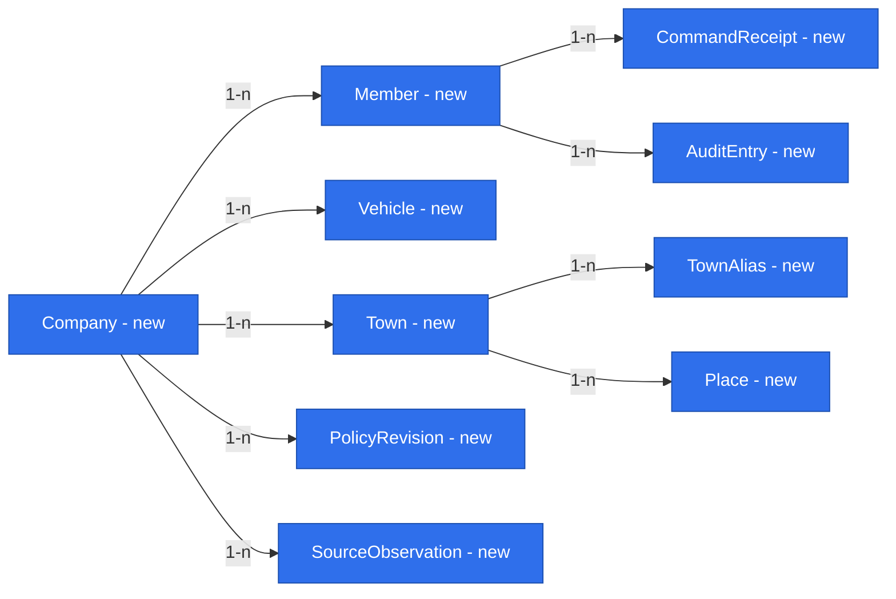

# E01 foundations — exact values, evidence, providers and access

Status: **ready for owner approval — all E01 owner policy questions resolved; not approved and not implemented**.
Date: 2026-10-26. Companion: [E01 feature](2026-10-26-e01-trip-entry-and-quotation.md). Shared owner: product owner. Scope: #18/#22–#26/#28, D33. This document introduces no standalone foundation release.

## 📝 TLDR

E01 needs repeatable financial calculations, dated source evidence, reliable place identity and secure company access before the dispatcher can use a quote on a call. The proposed foundations extend the existing four-package monolith only when an E01 phase consumes them. Both specifications share the research below and the feature’s phase plan; neither authorizes implementation or settles the explicitly open policies.

## Open Questions

No owner policy question remains for the agreed E01 scope. Owner answers of 2026-10-26 close FQ2/Q21 with D44/R18 (owner-invited personal company email/password using a maintained library), and late-data Q24 with D45/R19 (future E7 provisional/owner-closed months and next-open-month corrections). D43 already records the reaffirmed Europe/Warsaw weekend and is not duplicated. D38–D42 retain all earlier financial/source/full-day decisions.

These are owner policy decisions, not evidence that a provider, authentication library, source connection or financial calculation has been implemented. Library/version selection, verified deployment configuration, operational parameters and validation remain implementation readiness work under the approved contracts. Other brief questions (including Q04, Q08, Q12, Q17 and the rest of Q18) remain outside this scope; no new defaults answer them. Both linked specifications are ready for owner approval, which is distinct from approval or implementation authorization.

## 📝 Problem Statement and Proposed Solution

Existing code provides safe API/form/table composition, decimal-string syntax, framework-independent errors and request-scoped ORM access. It has no production authentication, financial policies, domain repositories or source/evidence presentation. A forked EntityManager does not implement authorization. Rechecking existing tests cannot demonstrate that these missing capabilities exist (foundation-completion lesson).

Use small public contracts and explicit server composition, not a module runtime, generic service hierarchy or generic ingestion platform. The feature owns trip lifecycle and financial decisions. Foundations own representation and boundaries, never another capability’s business records. Pure core accepts time, rates, policy and evidence explicitly; it never fetches data or resolves DI. No future module is scaffolded.

## 📝 Shared Research Base

Primary sources checked 2026-10-26; these observations support design choices, not evidence of adoption or provider readiness:

- [ERPNext quotation](https://docs.frappe.io/erpnext/quotation): submitted offers retain a formal revision path. Adopt frozen acceptance/corrections for R12; skip catalog pricing, tax workflows and a full sales pipeline. This is an architectural inference for E01, not a port.
- [Frappe users and permissions](https://docs.frappe.io/framework/user/en/basics/users-and-permissions): roles control resource operations. Adopt a small server-side permission matrix; skip the general permission designer and guest business access.
- [Open Mercato CRUD source](https://github.com/open-mercato/open-mercato/blob/4374c48def1654927805c4b760f0e7f8648280f2/packages/shared/src/lib/crud/factory.ts): a pinned open-source reference for shared route lifecycle. Existing `makeCrudRoute` already fills this role here; do not install or reproduce the surrounding framework.
- [Valhalla route API](https://valhalla.github.io/valhalla/api/route/api-reference/): truck parameters and administrative crossings are documented. Candidate adapter: configured truck-capable Valhalla endpoint, with explicit vehicle dimensions/restrictions and country-distance normalization. No service provisioning, paid commitment or live route validation is claimed. A deployment/provider can replace it through the same port if conformance proves the required country splits. Do not use public demo infrastructure as a production dependency.
- [decimal.js precision](https://mikemcl.github.io/decimal.js/#precision): ordinary operations can round at configured significant digits. Consequently merely selecting high precision does not prove R11. Use the bounded exact calculation contract below and independent tie/boundary fixtures.
- [Better Auth email/password](https://better-auth.com/docs/authentication/email-password) and [invitation lifecycle](https://better-auth.com/docs/plugins/organization), checked 2026-10-26: a maintained library can provide password hashing, email reset and invitation primitives. D44 selects the user flow, not a bespoke credential protocol; library capability must be proven before selection. Reuse only necessary admission/session operations, without adding teams or an organization hierarchy. Google/Microsoft and passwordless sign-in are no longer E01 alternatives.
- [NBP API](https://api.nbp.pl/en.html): dated queries can return no data; publication date is explicit. NBP is a candidate central-bank adapter, not a selected accounting fallback convention. D40/R15 now selects last-published fallback for non-publication/future dates; record the explicit rate direction and approved provider table in configuration, never assume a reciprocal or buy/sell convention.
- [MikroORM concurrency](https://mikro-orm.io/docs/transactions): use version checks and transactions; a DB transaction by itself does not make a delayed UI action safe. Trip acceptance validates an immutable quote and schedule versions under a per-truck concurrency boundary.

The feature also retains D12’s planning references (fireTMS, IMPARGO, Fleethand) from the brief. Detailed visual comparison belongs to the later #21 mockup. No new competitive superiority, real-source coverage, provider latency or user test is claimed.

## 📝 Architecture and Reuse

Dependency direction: app/server → core contracts/calculation and db adapters; app → ui; db → core contracts where needed. Core never imports app/db/ui/Next.js/Awilix/MikroORM. UI receives structural props, parsers and translated labels, never server repositories or ORM objects.

Identifiers below name proposed contracts, not implemented exports. Add public exports only with their first implementation; preserve all existing protected helpers and wire shapes in [backward compatibility](../../BACKWARD_COMPATIBILITY.md).

| Primitive | First phase | Later reuse |
|---|---|---|
| P01 Exact values | Phase 1 | E3, E7 |
| P02 Value evidence | Phase 1 | E3, E7 |
| P03 Dated inputs | Phase 1 | E3/E4 |
| P04 Place identity | Phase 1 | #28, E10a |
| P05 Scoped access | Phase 1 | All modules |
| P06 Authentication | Phase 1 | All modules |
| P07 Timed segments | Phase 1 | #24, E7 |
| P08 Revision commands | Phase 1 | E3, E11a |
| P09 Import identity | Phase 3 | E4, E10a |

Backlog derivation: #22–#24 need records, chronology and schedule projections; #25 needs pure calculations, policies and frozen revisions; #26/#28 need mapped invoice projections and resilient read-only ingestion. #19/#29–#31 are discovery work, not implementations. #20 identifies later comparison, automatic evidence, monthly reports, email proposals, bulk entry and component overrides; their boundaries guide reusable contracts without implementing those features. Chain verdict, live monitoring, forwarding, messaging and driver apps are not E01 primitives.

### P01 — Exact values and rounding

Reuse `decimalStringSchema` as lexical transport; feature schemas enforce unit, currency, sign and scale. Do not change its accepted syntax or convert money/fuel through JavaScript number. Financial DTOs carry strings and money currency; localized Polish decimal entry is normalized as text before validation. Positive/negative zeros normalize for display; known zero remains known.

Owner-approved output policy R11: EUR net money totals at scale 2; unit prices, FX and consumption at 6; km/litres at 3; ties half-up including negative values away from zero. Round each published aggregate once from exact underlying values. Keep unrounded component expressions for the total; do not sum rounded component displays into a total. Show a distinct rounding reconciliation line if displayed components differ from the published aggregate. Comparisons, negative-quote reasoning and sorting by monetary outcome use the published rounded final result; there is no verdict engine.

Proposed storage: `numeric(30,2)` for published totals, `numeric(30,6)` for published rates and `numeric(30,3)` for published km/litres. Normalized input contracts bound finite magnitude and scale before database writes; source decimals beyond output scale are preserved as canonical text plus original unit/currency, not silently truncated by numeric column assignment. Reject out-of-range output explicitly instead of overflow/truncation. No operational parameter values are stored in source code.

Exactness strategy for this small formula set: represent non-terminating intermediate quotients (FX conversion and elapsed-seconds-to-days) as signed integer numerator/positive denominator decimal-string expressions. Use decimal.js integer addition/multiplication at a precision derived from validated operand digit counts and bounded term counts, so those operations do not round. Divide only for final rounding using quotient/remainder; compare twice the absolute remainder to the positive denominator for half-up. Do not use a fixed significant-digit default or a pre-rounded inverse FX rate. This is a restricted arithmetic helper for approved formulas, not a symbolic algebra framework; internal rational pairs are not public transport. Validate digit/term caps and reject excess before allocating large operands. Materialized snapshots retain exact inputs/formula version sufficient to reproduce the quotient. Unit tests must independently prove below/on/above ties, negative ties, long reciprocals and aggregation; decimal.js presence alone is not proof.

### P02 — Value with evidence

Proposed `EvidenceValue` in core/contracts carries three independent axes: `phase: plan|actual`, `state: known|missing|conflicting`, and, for a known value, `certainty: certain|estimated`. E01 quote inputs/results have phase `plan`. Phase 3’s invoice-history price has phase `actual` only for the metric `invoicedPrice` (the historical invoice field); its R02 certainty remains `estimated` for this comparison per D28. It is not `actualTripCost` or `actualTripResult`, and no invoice row may supply those metrics. Thus the existing plan/actual contract has an E01 source-context consumer without implementing E3/E4 settlement. Entered-trip history results remain phase `plan` until that later specification supplies measured actuals.

Known shape: `{ value: DecimalString, unit, currency?, certainty, reasonCodes, sources: SourceRef[], observedAt, effectiveFrom, effectiveTo?, receivedAt, calculatedAt?, calculationVersion?, policyRevision? }`. SourceRef contains opaque tenant-owned evidence ID, provider kind, source revision, field identity and scope; it never contains connection strings or source record bodies. Missing has required reason and field identity. Conflicting retains compatible candidates and blocks a complete result until resolved. Keep source and selected override side by side.

Derived values retain all effective source/rate revisions; any estimated required input makes the derived value estimated. User confirmation of a planner number does not turn it into measured distance. A validated card amount is not proof of litres consumed by a trip. A source may support one field and not another. No driver-based consumption is introduced. UI `ValueWithSource` renders exact value/unit/currency, Polish certainty text, source date/reason and accessible details; its props are structural, supplied by app. Missing/conflicting/partial is never a zero or a color-only badge.

### P03 — Dated inputs

Core ports: `RouteEstimatePort`, `QuoteInputPort` and `InvoiceHistoryPort` (Phase 3); provider DTOs are validated by adapters. `QuoteInputPort.resolve(scope, request)` requests vehicle, country, load state, required metric and segment/business date; returns evidence values plus explicit coverage and method versions. It is not an open SQL/query endpoint.

Owner-approved source resolution (D39/D40; R14/R15):

1. **Fuel country price:** within the 14-day lookback, select the last up to three distinct days with own-card refuelling in that country and compute `sum(net amount) / sum(litres)` across their qualifying transactions, retaining selected dates, period, quantities and source revisions. This is litre-weighted, not an average of daily averages. If no usable own-card price exists, use public pump price for the requested date when published; for a future trip use the latest published price on or before quote as-of, retain its publication date and label it as an estimate under R07, then subtract the company’s typical country discount, whose method is the median of same-day card/public price pairs. Missing usable public price or discount means this branch is unavailable, not zero discount. Then a dispatcher-entered manual price with effective date/age at most 14 days; otherwise return `no fuel price for <country>`. All substitutions and periods are visible estimates as appropriate. No expired manual value or unlabelled borrowing from a different country.
2. **EUR FX:** central-bank rate for the requested date; on weekends, holidays and future dates use the last published rate available at the quote’s as-of time, retaining publication/effective date and rate direction. Future-date use is estimated; a missing required central-bank series remains missing, not a synthetic rate. An accepted quote never changes when a new publication arrives.
3. **Consumption:** the selected vehicle’s own CAN history by country and load state when it passes owner-approved sufficiency thresholds; otherwise fleet average for the same country/load state. Preserve source/method/period and why fallback was used. No driver identity or per-person rate. If neither source is sufficient, expose the missing input under D30’s source-gap rules rather than using a hidden default.
4. **Tolls:** country cost per kilometre measured from fuel-card toll transactions for the last closed month; preserve period, measurement basis and currency. Route-planner route-specific toll is shown beside it as a control, never added to the cost or silently substituted for the measured country rate.
5. **Fixed costs:** use the existing external measured monthly per-vehicle division calculation for its last closed month, supplying category-level vehicle-day rates for leasing, insurance, telematics, service package, tank rental, division fixed costs and driver cost. Driver cost is only an aggregate per vehicle-day, never per person. The provider returns the existing day-rate calculation, closure/version, source month, category coverage and a separate labour component so R13 can adjust it without double counting. Do not invent a monthly divisor, recompute payroll or add a percentage surcharge. Required unavailable source/rate/breakdown makes the affected quote incomplete; an intentionally uncovered category is displayed as `notIncluded`, never zero.
6. **AdBlue:** retain the owner-set dated rate with explicit units/currency under D30. No extra allocation or automatic procurement behavior is introduced.

Lookbacks and published source data are evaluated at the captured quote as-of/date context; future quotes cannot use future transactions/publications. Source/method revisions distinguish the selected data from the trip date it estimates. Exact window boundary timestamps, approved sufficiency/sample thresholds, public/card net normalization and the provider’s central-bank table/direction are explicit versioned provider configuration approved by the owner, not hard-coded operational constants. A public/card discount requires comparable same-day prices, compatible country/currency and net basis; missing comparability cannot create a claimed discount. Configuration values, operational rates, payroll and raw source rows never enter Git. These are readiness inputs, not permission to access production during this run.

Weekend labour (R13): for a quote whose elapsed interval includes a weekend, require an explicit `weekendCase`: `homePoland`, `restAbroad` or `drivingOn`. No answer means incomplete with the Polish message “Zapytaj o weekend”. Vehicle categories continue over all elapsed time. Home in Poland excludes the weekend-day labour overlap; reduced weekly rest abroad replaces normal labour on those days with the dated owner-set flat labour amount per weekend day; driving on retains normal elapsed labour. Never add both normal and replacement labour on the same interval. Use exact local-day/UTC boundaries and stored timezone from P07, and retain the dispatcher answer and flat-rate policy revision. D42/R17 resolves partial-day charging in the abroad-flat case: the entire dated flat amount applies to each touched weekend calendar day, never prorated. A trip-wide weekendCase applies to every weekend covered by that quote, matching R13’s one-choice-per-quote contract; mixed cases within a single quote are not represented or silently inferred. D43 fixes calendar days and timezone to Saturday 00:00–Monday 00:00 Europe/Warsaw, irrespective of P07’s endpoint/segment zones. Partition elapsed time at these Warsaw local boundaries, convert them to UTC instants, and count local touched days under the same half-open interval rule; never use a constant CET offset across DST. Store the calendar/timezone/policy reference with the accepted quote. Aggregate source evidence indicates mixed weekend situations; no universal case is preselected. No fleet/customer percentages are reproduced here.

Manual source-gap replacement includes actor/date/reason/original missing state and may not overwrite existing valid source evidence. Fuel manual fallback specifically follows the ordered hierarchy above. Net/gross uncertainty, unknown currency, unresolved country or inadequate/expired input remains visible and can prevent a complete quote. A documented excluded fixed-cost category does not become an invented overhead input; result coverage must be displayed.

All operational reads are read-only and explicitly scoped to the authorized company/provider account. Credentials and hostnames belong in deployment configuration. Permit only approved fields/queries/views; no payroll/person data. Provider implementation may call an existing internal read-only interface rather than share its database with the application. No production connection is touched while specifying.

Fetch outside write transactions with bounded timeout/retry and cancellation; cache only with tenant/provider/account/metric/vehicle/country/load state/effective date/method version keys. Return `unavailable`, `notFound`, `stale`, `unmatched` separately. A refresh creates new evidence, never changes an accepted snapshot. Complete quotes can remain readable during an outage; a new incomplete calculation lists missing sources and cannot be accepted. No synchronous UI retry loop, invented zero, silently borrowed vehicle value or hidden public-price fallback.

### P04 — Place identity

`Town` has tenant-scoped ID, canonical display name, optional confirmed country/region and ambiguity status. Its identity is not the normalized name alone. `TownAlias` maps a normalized source string/context to a person-confirmed town, with actor/revision. Normalize Unicode/case/diacritics and whitespace/punctuation into a candidate key; minor variants suggest review, never automatically combine distinct towns. Identical names in different regions/countries remain ambiguous until confirmed. Country is not invented when invoice notes omit it.

`Place` belongs to one Town and may retain full address and geocoded coordinates for routing. Directed town pair is the history key; exact Place IDs are route endpoints. A town alias edit changes future projections/reviews, not accepted endpoint snapshots. Route-note parsing yields loading/unloading candidates with confidence/reason, never bag-of-words matching. A district/site must be resolved to its town by a person if uncertain. Expose suggestions and mapping actions through the owner capability, not raw cross-module writes.

### P05 — Scoped access / P06 — Authentication

Every company-owned row, join, evidence, import batch, audit record and business revision has non-null tenantId. Every read/count/lookup/write filters by tenant; tenant-qualified constraints prevent foreign-company references. Reuse immutable `RequestScope {tenantId, actorId}` and isolated EntityManager. Missing identity, membership or permission denies access on HTTP, server components and background operations. Tests must attack both tenants and child/source references.

D34’s retained identity restrictions, refined by D44/R18, require verified control of an exact owner-approved personal company address AND active membership. An allowed domain alone cannot establish that an address is personal. The owner maintains an admitted-person roster; reject shared/role mailboxes, aliases pretending to be additional users and unlisted addresses even on the domain. Do not infer personal status from name spelling. Use case-insensitive normalized domain and a documented stable address comparison policy; keep original verified address privately. Changing an address is an explicit owner-reviewed rebinding and session revocation, not automatic account linking.

Permissions: dispatcher may read E01 fleet/history, create/edit unaccepted trips, quote, accept, request correction/cancellation and confirm route-town aliases. Owner has those permissions plus admitting/revoking users, assigning roles and approving dated financial configuration. Dispatcher source-gap inputs are audited, not general policy edits. Library-owned identity/session/token records are distinct from tenant-owned memberships; scope identities through membership, never trust callback/request tenant IDs. No open self-signup, shared credentials or automatic account linking. Owner invitations bind the exact admitted address, company and intended role server-side; accepting an invite cannot choose a different email, company or role.

D44/R18 selects **personal company email and password**, with the company mail domain served by a hosting provider’s mail server. There is no Google/Microsoft login or passwordless sign-in branch. A maintained authentication library owns password hashing and verification, salts/parameters and upgrades, invitation/setup/reset token generation, storage and single-use expiry, and session creation/revocation. Do not implement custom crypto, hash formats, password comparison, random token protocols or a replacement authentication system. Select and pin a maintained library/version with supported Next.js/storage integration and demonstrate all required lifecycle operations before Phase 1; that technical choice is not another owner policy question.

Owner-only invitation creates a pending admission bound to a single personal company address and role. Invite email leads to the library-managed first-password setup; mailbox control, invitation validity, domain and active roster are verified before activation. No access to trip data or owner permissions before completion, no public signup merely because an email is on the domain, and no reusable/password-in-email invitation. Revocation or expiry invalidates setup. Disable or reject every exposed library registration/invite endpoint that could bypass owner admission; domain validation alone is insufficient. Mail delivery credentials and links remain private deployment/runtime data; send no real invitations in this specification run.

Sign-in verifies credentials through the library and rechecks active membership; passwords never reach logs, audit payloads or business DTOs and only secure library-managed hashes are stored. Password-reset email is available only to the admitted personal address, with generic responses and bounded request/attempt limits to avoid enumeration and brute force. The library’s expiring, single-use reset flow must not activate an uninvited/revoked identity or change company/role. Reset revokes existing sessions; roster removal also revokes sessions and blocks password reset from restoring access. The owner cannot retrieve or send a user’s password.

Use library-supported secure password policy and hashing defaults verified against its current documentation; do not create a homegrown password policy/crypto stack. Secure/HttpOnly/SameSite session cookies, origin/CSRF checks, safe redirect allowlists and server-side permissions apply on every path. Email outage prevents setup/reset completion, never bypasses access; show a safe retry state without leaking membership. Existing authenticated sessions follow normal library validity while membership is checked. Test only synthetic addresses/passwords; no real domain/address, token, hash, mail-server secret or password goes into repository evidence.

### P07–P09 — Time, revision and import boundaries

Store every planned movement/stationary segment with exact UTC `startAt`/`endAt`, original IANA timezone(s), half-open interval `[start,end)`, kind, vehicle, load state and ordered endpoints. Distinguish planned from observed time/distance and include source refs. Reject nonexistent local DST times; require offset selection for ambiguous times. Zero-duration point events are not invented distance-bearing segments. Loading/unloading/wash scheduling and elapsed-cost coverage must cover the trip boundary with no unexplained temporal holes.

An unassigned approach segment remains tenant/vehicle-owned when no next trip exists; assigning it creates an allocation relation without changing segment identity. Never duplicate kilometres when a next trip claims the approach. Retain cross-midnight boundaries and evidence sufficient for later monthly allocation, and preserve the distinction between measured and estimated boundary distance. D41 selects GPS odometer at local midnight for future E7; missing GPS uses a time-proportional split labelled “estimate: time-proportional split”, never an unfilled monthly gap. E01 stores exact segment timestamps and source references only; it does not add a GPS collector or execute a monthly split. D45/R19 now resolves the future E7 late-data rule: keep month figures provisional until required documents/data are present and the owner explicitly closes; a later document/correction is recorded in the next open month with a closed-month reference, never rewriting the closed figures. E01 does not close, calculate or restate monthly reports.

Immutable quote/trip revisions and `CommandReceipt` enforce retries and correction history. Same tenant/actor/command key + same payload returns the recorded result; changed payload conflicts. Financial transitions, revision/audit/receipt and schedule-version update commit together. Imports later deduplicate `(tenant, providerAccount, sourceId, sourceRevision)`; correction replaces the current projection without deleting earlier evidence, and omitted rows are not deletions. Import job state/cursor/error codes remain observable. No durable event/outbox is needed until an actual E01 asynchronous required consumer exists.

## 📝 Data Model

New minimal records: Company (timezone/domain policy), Member (one personal address, role, status), Vehicle (reference/truck profile), Town, TownAlias, Place, PolicyRevision, SourceObservation, CommandReceipt and AuditEntry. Library credential/invitation/session/reset-token tables follow the selected maintained library; do not invent their schema here. Vehicle registry belongs to assets; towns/places to counterparties per standards; identity/configuration are server platform boundaries. Feature records reference them by tenant-qualified IDs, not writable ORM graphs.

PolicyRevision stores effective interval, metric/rule identity, approved actor and immutable value/method reference. SourceObservation stores normalized permitted value, original amount/currency, effective/received times, provider reference/revision, certainty and scoped source/document references, never a full operational export. A DocumentRef is an opaque tenant-qualified source/account/document ID and revision, with effective/received timestamps; it is not a download URL, document body, payroll record or a second document store. Preserve provider-supplied references through corrections and accepted snapshots so E7 can trace required evidence and subsequent correction documents. E01 creates no month checklist, closure/posting ledger or payroll importer. Do not make a source reference a second customer/employee register. Child data is non-null tenant-scoped; enforce `(tenantId,id)` uniqueness and composite reference integrity. Tables containing real data require reviewed migrations and disposable backup/restore exercises before deployment.

All nodes are proposed new records; the current ORM has no business entities. Source/actor links use explicit scoped references; the diagram omits repeated company edges for readability where ownership is stated above. Feature relationships are in the companion; neither graph represents shipped schema. No interactive HTML is needed for these small graphs.

## 📝 API Contracts and UI/UX

Reuse the existing result envelope and Zod-derived DTOs. Standard reference/config CRUD uses `makeCrudRoute`; financial/lifecycle operations use `apiHandler`. No shared helper is copied or weakened. Client-side application API calls go through `apiCall`. Shared errors keep safe translated message keys/correlation ID; missing input lists use explicit `missingFields`, not raw provider error text.

Foundation surfaces consumed by the feature: scoped vehicle/place lists; town-alias confirmation command; authorized source-gap fill command; owner-only policy/member operations; `resolveQuoteInputs` and `estimateRoute` server use cases, never unrestricted provider proxies. Expose only allowed reference CRUD methods. Existing builder cannot filter lists by arbitrary fields or enforce concurrency versions by itself; add typed explicit list filters/version preconditions centrally and test compatibility before feature consumers, rather than sending unsupported query parameters or mislabelling CRUD as commands.

Minimal UI additions: `DecimalField` (string-only), `ZonedDateTimeField` (explicit zone/offset), `PlacePicker` (address versus town distinction), `ValueWithSource`, and typed composition slots in `CrudForm` for these widgets. Preserve its pending/error/dirty/keyboard behaviors and existing field API. Use `DataTable` for ordinary lists; a dedicated result breakdown composes value components and shared feedback. Accessible labels, error focus, keyboard access and meaningful text apply. No second UI toolkit, copied form or generic report builder.

## 📝 Edge Cases, Risks and Validation

Reject cross-company record references, unverified/role mailbox access, expired/reused invitation/setup/reset tokens, stale membership, CSRF failures, overflows and unsupported currency before a write. Unknown zero, source outage, conflicting evidence, missing date, DST ambiguity, ambiguous towns, partial country distances and future/unpublished prices remain distinguishable. Never “repair” them by rounding, guessing or dropping a row. Preserve user edits on failure and require acknowledgement when an input refresh changes the quote.

Hard-to-reverse choices are identity binding, town merges, accepted input snapshots and segment/time boundaries. All require audit and revisions. Restore a mapping by a new alias revision; revoke an account/session without deleting financial history; recover migrations by a reviewed forward fix or a tested disposable rollback before real data. Cross-tenant attacks, concurrency races, exact decimal round trips and duplicate provider corrections need PostgreSQL integration evidence, not only helper mocks. Public API/schema contracts join BACKWARD_COMPATIBILITY in the implementing phase.

## 📝 Decisions in play

Binding: R02–R05, R07, R09–R19; R08 as refined by R10; D16–D24, D26–D45 with their supersession metadata; N01–N04, with N05 still a proposal. This design does not decide per-driver estimates, monthly management purpose or other modules. Existing engineering standards apply fully. Owner gate Q1–Q15 answers, not agent defaults, supply the policy selections; D38–D41 resolve FQ1/FQ3/FQ4/FQ5 split; FQ6 is resolved by D42/R17, FQ7 by D43, FQ2 by D44/R18 and late-data Q24 by D45/R19. Both documents are ready for owner approval; E7 behavior is specified as a future boundary, not implemented here.

## 📋 Phasing and Implementation Plan

Phase names/step IDs are shared with the [feature plan](2026-10-26-e01-trip-entry-and-quotation.md#-implementation-plan); that document is the single step checklist. Every step preserves the existing application; no foundation-only release precedes Phase 1.

- **Before Phase 1:** obtain owner approval of both specifications, select/verify the maintained email/password library and approve deployment/provider configuration; #21 checks a synthetic mockup against both. The approved direction is D44/R18 email/password, with no alternative login branch. Calendar D43 and policies D38–D45 do not by themselves authorize implementation.
- **Phase 1, steps 1.1–1.5:** introduce P01–P08 with the first real trip-entry/quote/acceptance consumer. Validate exact arithmetic and provenance, company access and two-tenant constraints before any real-data deployment. Required provider checks use synthetic fixtures; approved live readiness checks happen separately without data in Git/logs.
- **Phase 2, steps 2.1–2.2:** reuse these foundations for availability and kilometre checks; add only the needed projection and evidence attachment behavior. Monthly report stays out.
- **Phase 3, steps 3.1–3.2:** introduce P09 with the read-only invoice history and reuse town/value/source UI. Test corrections, replay and mapping failures; do not implement E4 actual costs.

Acceptance of these foundations is measured through those consuming phases: 100% statements/branches/functions/lines over the required source roots; all configured validation commands; two-tenant persistence, concurrency, provider-contract and decimal tests; browser screenshots for every changed flow. Documentation review is not execution of that future validation.
