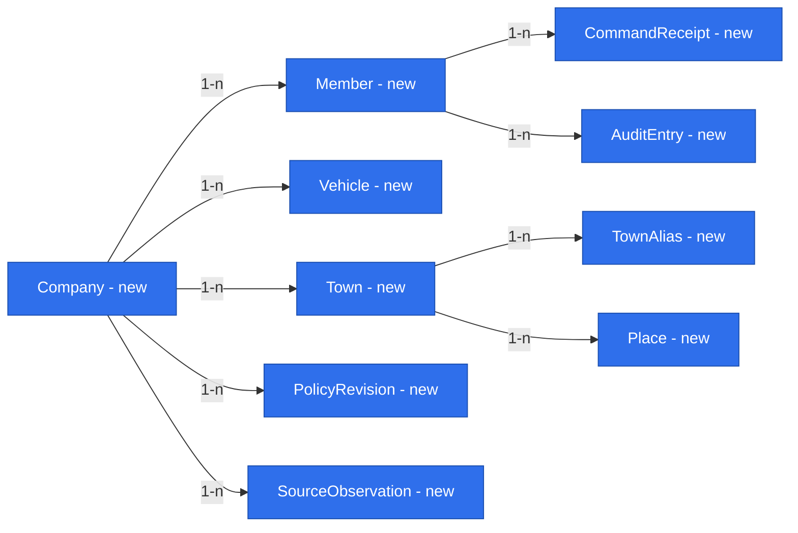

# E01 foundations — exact values, evidence, providers and access

Status: **design draft; owner gate answers applied; implementation blocked on listed open policies and specification approval**.
Date: 2026-10-26. Companion: [E01 feature](2026-10-26-e01-trip-entry-and-quotation.md). Shared owner: product owner. Scope: #18/#22–#26/#28, D33. This document introduces no standalone foundation release.

## 📝 TLDR

E01 needs repeatable financial calculations, dated source evidence, reliable place identity and secure company access before the dispatcher can use a quote on a call. The proposed foundations extend the existing four-package monolith only when an E01 phase consumes them. Both specifications share the research below and the feature’s phase plan; neither authorizes implementation or settles the explicitly open policies.

## Open Questions

The owner explicitly requested that weekend labour and authentication method remain open while both documents are completed. Their contracts are designed below, but affected production work cannot ship without answers. Newly identified financial/measurement choices are also left unresolved; no autonomous defaults apply.

- **FQ1 — Weekend labour:** use the same hourly labour rate every day, or dated day-specific rates? Owner decision required; recommend an explicit dated calendar rule, without inventing a premium or zero. Missing weekend policy makes a quote spanning that weekend incomplete.
- **FQ2 — Authentication:** which company mail provider hosts the domain, and use Google/Microsoft sign-in or a one-time company-email link? Owner decision required; recommend provider sign-in if available, otherwise the library’s email-link flow. Both must satisfy D34; choose neither here.
- **FQ3 — Overhead:** is it a dated fixed amount/rate over elapsed time, or a percentage of revenue? Which configured value applies? Owner decision required; recommend using an explicitly approved existing company rule rather than porting the older percentage silently. Missing policy is not zero; no complete final result until resolved.
- **FQ4 — Operational estimates and date selection:** approve (or replace) this proposal: latest validated country/vehicle/load-state aggregate effective on or before the segment date, no future leakage; consumption and card/toll aggregation window, net-price conversion and permitted source age are explicit provider configuration approved by the owner. Recommend preserving an existing documented methodology if available. The current evidence does not establish its algorithm, freshness limits or accuracy. An effective-date-missing central-bank rate (weekend/future) needs an approved previous-publication fallback, visibly estimated; no undocumented rate substitution.
- **FQ5 — Cross-midnight movement:** if only total distance and start/end timestamps are known, may an estimated time-proportional split be used, or must the monthly split remain unresolved until timed distance evidence exists? Recommend unresolved without evidence; timestamps alone do not establish which kilometres/costs occurred in each month. E01 can store segments and uncertainty now; E7 must resolve this before freezing month figures. Late evidence/corrections to frozen months also need an explicit E7 rule; do not rewrite D32’s frozen figures.

These are localized blockers, not claims that E01’s agreed scope is undecided. FQ1/FQ3/FQ4 block complete affected financial quotations; FQ2 blocks real-data access; FQ5 blocks future monthly closure, not E01 segment storage. A01/A06 adoption, A03 matching and A05 estimate quality remain unvalidated premises, not new defaults. Brief Q04 (per-driver input), Q08, Q12, Q17 and remaining Q18 stay outside this design’s authority.

## 📝 Problem Statement and Proposed Solution

Existing code provides safe API/form/table composition, decimal-string syntax, framework-independent errors and request-scoped ORM access. It has no production authentication, financial policies, domain repositories or source/evidence presentation. A forked EntityManager does not implement authorization. Rechecking existing tests cannot demonstrate that these missing capabilities exist (foundation-completion lesson).

Use small public contracts and explicit server composition, not a module runtime, generic service hierarchy or generic ingestion platform. The feature owns trip lifecycle and financial decisions. Foundations own representation and boundaries, never another capability’s business records. Pure core accepts time, rates, policy and evidence explicitly; it never fetches data or resolves DI. No future module is scaffolded.

## 📝 Shared Research Base

Primary sources checked 2026-10-26; these observations support design choices, not evidence of adoption or provider readiness:

- [ERPNext quotation](https://docs.frappe.io/erpnext/quotation): submitted offers retain a formal revision path. Adopt frozen acceptance/corrections for R12; skip catalog pricing, tax workflows and a full sales pipeline. This is an architectural inference for E01, not a port.
- [Frappe users and permissions](https://docs.frappe.io/framework/user/en/basics/users-and-permissions): roles control resource operations. Adopt a small server-side permission matrix; skip the general permission designer and guest business access.
- [Open Mercato CRUD source](https://github.com/open-mercato/open-mercato/blob/4374c48def1654927805c4b760f0e7f8648280f2/packages/shared/src/lib/crud/factory.ts): a pinned open-source reference for shared route lifecycle. Existing `makeCrudRoute` already fills this role here; do not install or reproduce the surrounding framework.
- [Valhalla route API](https://valhalla.github.io/valhalla/api/route/api-reference/): truck parameters and administrative crossings are documented. Candidate adapter: configured truck-capable Valhalla endpoint, with explicit vehicle dimensions/restrictions and country-distance normalization. No service provisioning, paid commitment or live route validation is claimed. A deployment/provider can replace it through the same port if conformance proves the required country splits. Do not use public demo infrastructure as a production dependency.
- [decimal.js precision](https://mikemcl.github.io/decimal.js/#precision): ordinary operations can round at configured significant digits. Consequently merely selecting high precision does not prove R11. Use the bounded exact calculation contract below and independent tie/boundary fixtures.
- [Auth.js email provider](https://authjs.dev/getting-started/authentication/email): email-link sign-in requires persisted verification tokens. A maintained library must own this protocol; the selected library/version and provider remain implementation prerequisites under FQ2. Do not inherit an example’s expiry as approved company policy.
- [NBP API](https://api.nbp.pl/en.html): dated queries can return no data; publication date is explicit. NBP is a candidate central-bank adapter, not a selected accounting fallback convention. FQ4 must settle the table/rate direction and non-publication-day policy.
- [MikroORM concurrency](https://mikro-orm.io/docs/transactions): use version checks and transactions; a DB transaction by itself does not make a delayed UI action safe. Trip acceptance validates an immutable quote and schedule versions under a per-truck concurrency boundary.

The feature also retains D12’s planning references (fireTMS, IMPARGO, Fleethand) from the brief. Detailed visual comparison belongs to the later #21 mockup. No new competitive superiority, real-source coverage, provider latency or user test is claimed.

## 📝 Architecture and Reuse

Dependency direction: app/server → core contracts/calculation and db adapters; app → ui; db → core contracts where needed. Core never imports app/db/ui/Next.js/Awilix/MikroORM. UI receives structural props, parsers and translated labels, never server repositories or ORM objects.

Identifiers below name proposed contracts, not implemented exports. Add public exports only with their first implementation; preserve all existing protected helpers and wire shapes in [backward compatibility](../../BACKWARD_COMPATIBILITY.md).

| Primitive | First phase | Later reuse |
|---|---|---|
| P01 Exact values | Phase 1 | E3, E7 |
| P02 Value evidence | Phase 1 | E3, E7 |
| P03 Dated inputs | Phase 1 | E3/E4 |
| P04 Place identity | Phase 1 | #28, E10a |
| P05 Scoped access | Phase 1 | All modules |
| P06 Authentication | Phase 1 | All modules |
| P07 Timed segments | Phase 1 | #24, E7 |
| P08 Revision commands | Phase 1 | E3, E11a |
| P09 Import identity | Phase 3 | E4, E10a |

Backlog derivation: #22–#24 need records, chronology and schedule projections; #25 needs pure calculations, policies and frozen revisions; #26/#28 need mapped invoice projections and resilient read-only ingestion. #19/#29–#31 are discovery work, not implementations. #20 identifies later comparison, automatic evidence, monthly reports, email proposals, bulk entry and component overrides; their boundaries guide reusable contracts without implementing those features. Chain verdict, live monitoring, forwarding, messaging and driver apps are not E01 primitives.

### P01 — Exact values and rounding

Reuse `decimalStringSchema` as lexical transport; feature schemas enforce unit, currency, sign and scale. Do not change its accepted syntax or convert money/fuel through JavaScript number. Financial DTOs carry strings and money currency; localized Polish decimal entry is normalized as text before validation. Positive/negative zeros normalize for display; known zero remains known.

Owner-approved output policy R11: EUR net money totals at scale 2; unit prices, FX and consumption at 6; km/litres at 3; ties half-up including negative values away from zero. Round each published aggregate once from exact underlying values. Keep unrounded component expressions for the total; do not sum rounded component displays into a total. Show a distinct rounding reconciliation line if displayed components differ from the published aggregate. Comparisons, negative-quote reasoning and sorting by monetary outcome use the published rounded final result; there is no verdict engine.

Proposed storage: `numeric(30,2)` for published totals, `numeric(30,6)` for published rates and `numeric(30,3)` for published km/litres. Normalized input contracts bound finite magnitude and scale before database writes; source decimals beyond output scale are preserved as canonical text plus original unit/currency, not silently truncated by numeric column assignment. Reject out-of-range output explicitly instead of overflow/truncation. No operational parameter values are stored in source code.

Exactness strategy for this small formula set: represent non-terminating intermediate quotients (FX conversion and seconds-to-hours) as signed integer numerator/positive denominator decimal-string expressions. Use decimal.js integer addition/multiplication at a precision derived from validated operand digit counts and bounded term counts, so those operations do not round. Divide only for final rounding using quotient/remainder; compare twice the absolute remainder to the positive denominator for half-up. Do not use a fixed significant-digit default or a pre-rounded inverse FX rate. This is a restricted arithmetic helper for approved formulas, not a symbolic algebra framework; internal rational pairs are not public transport. Validate digit/term caps and reject excess before allocating large operands. Materialized snapshots retain exact inputs/formula version sufficient to reproduce the quotient. Unit tests must independently prove below/on/above ties, negative ties, long reciprocals and aggregation; decimal.js presence alone is not proof.

### P02 — Value with evidence

Proposed `EvidenceValue` in core/contracts carries three independent axes: `phase: plan|actual`, `state: known|missing|conflicting`, and, for a known value, `certainty: certain|estimated`. E01 quote inputs/results have phase `plan`. Phase 3’s invoice-history price has phase `actual` only for the metric `invoicedPrice` (the historical invoice field); its R02 certainty remains `estimated` for this comparison per D28. It is not `actualTripCost` or `actualTripResult`, and no invoice row may supply those metrics. Thus the existing plan/actual contract has an E01 source-context consumer without implementing E3/E4 settlement. Entered-trip history results remain phase `plan` until that later specification supplies measured actuals.

Known shape: `{ value: DecimalString, unit, currency?, certainty, reasonCodes, sources: SourceRef[], observedAt, effectiveFrom, effectiveTo?, receivedAt, calculatedAt?, calculationVersion?, policyRevision? }`. SourceRef contains opaque tenant-owned evidence ID, provider kind, source revision, field identity and scope; it never contains connection strings or source record bodies. Missing has required reason and field identity. Conflicting retains compatible candidates and blocks a complete result until resolved. Keep source and selected override side by side.

Derived values retain all effective source/rate revisions; any estimated required input makes the derived value estimated. User confirmation of a planner number does not turn it into measured distance. A validated card amount is not proof of litres consumed by a trip. A source may support one field and not another. No driver-based consumption is introduced. UI `ValueWithSource` renders exact value/unit/currency, Polish certainty text, source date/reason and accessible details; its props are structural, supplied by app. Missing/conflicting/partial is never a zero or a color-only badge.

### P03 — Dated inputs

Core ports: `RouteEstimatePort`, `QuoteInputPort` and `InvoiceHistoryPort` (Phase 3); provider DTOs are validated by adapters. `QuoteInputPort.resolve(scope, request)` requests vehicle, country, load state, required metric and segment/business date; returns evidence values plus explicit coverage and method versions. It is not an open SQL/query endpoint.

Owner source order: country/date card fuel price then public-price estimate if absent; fleet consumption by vehicle/country/load state or that vehicle’s history; card-measured country toll per km; central-bank EUR rate; owner-set AdBlue rate. Manual source-gap replacement includes actor/date/reason/original missing state and may not overwrite existing valid source evidence. Net/gross uncertainty, unknown currency, unresolved country, unapproved date fallback or stale source cannot create a complete result. FQ4 settles provider aggregation/date/freshness policy rather than letting adapter code invent it.

All operational reads are read-only and explicitly scoped to the authorized company/provider account. Credentials and hostnames belong in deployment configuration. Permit only approved fields/queries/views; no payroll/person data. Provider implementation may call an existing internal read-only interface rather than share its database with the application. No production connection is touched while specifying.

Fetch outside write transactions with bounded timeout/retry and cancellation; cache only with tenant/provider/account/metric/vehicle/country/load state/effective date/method version keys. Return `unavailable`, `notFound`, `stale`, `unmatched` separately. A refresh creates new evidence, never changes an accepted snapshot. Complete quotes can remain readable during an outage; a new incomplete calculation lists missing sources and cannot be accepted. No synchronous UI retry loop, invented zero, silently borrowed vehicle value or hidden public-price fallback.

### P04 — Place identity

`Town` has tenant-scoped ID, canonical display name, optional confirmed country/region and ambiguity status. Its identity is not the normalized name alone. `TownAlias` maps a normalized source string/context to a person-confirmed town, with actor/revision. Normalize Unicode/case/diacritics and whitespace/punctuation into a candidate key; minor variants suggest review, never automatically combine distinct towns. Identical names in different regions/countries remain ambiguous until confirmed. Country is not invented when invoice notes omit it.

`Place` belongs to one Town and may retain full address and geocoded coordinates for routing. Directed town pair is the history key; exact Place IDs are route endpoints. A town alias edit changes future projections/reviews, not accepted endpoint snapshots. Route-note parsing yields loading/unloading candidates with confidence/reason, never bag-of-words matching. A district/site must be resolved to its town by a person if uncertain. Expose suggestions and mapping actions through the owner capability, not raw cross-module writes.

### P05 — Scoped access / P06 — Authentication

Every company-owned row, join, evidence, import batch, audit record and business revision has non-null tenantId. Every read/count/lookup/write filters by tenant; tenant-qualified constraints prevent foreign-company references. Reuse immutable `RequestScope {tenantId, actorId}` and isolated EntityManager. Missing identity, membership or permission denies access on HTTP, server components and background operations. Tests must attack both tenants and child/source references.

D34 admission requires verified control of an exact owner-approved personal company address AND active membership. An allowed domain alone cannot establish that an address is personal. The owner maintains an admitted-person roster; reject shared/role mailboxes, aliases pretending to be additional users and unlisted addresses even on the domain. Do not infer personal status from name spelling. Use case-insensitive normalized domain and a documented stable address comparison policy; keep original verified address privately. Changing an address is an explicit owner-reviewed rebinding and session revocation, not automatic account linking.

Permissions: dispatcher may read E01 fleet/history, create/edit unaccepted trips, quote, accept, request correction/cancellation and confirm route-town aliases. Owner has those permissions plus admitting/revoking users, assigning roles and approving dated financial configuration. Dispatcher source-gap inputs are audited, not general policy edits. Library-owned identity/session/token records are distinct from tenant-owned memberships; scope identities through membership, never trust callback/request tenant IDs. No open self-signup or automatic OAuth account linking by email.

FQ2 deliberately leaves Google/Microsoft versus one-time link open. Both paths use a maintained library for verified identity, sessions, protocol state/nonce/PKCE where applicable, expiring single-use tokens and revocation; no custom passwords. Link delivery verifies the same admitted address before and after redemption; rate-limit requests and respond generically to prevent membership enumeration. Secure/HttpOnly/SameSite cookies, CSRF/origin checks and safe redirect allowlists apply. Provider/email outage cannot bypass login. Tokens, addresses and callback bodies stay out of logs and repository fixtures (`dispatcher@example.test` is synthetic). Select and pin the maintained implementation only after provider/method confirmation and compatibility review.

### P07–P09 — Time, revision and import boundaries

Store every planned movement/stationary segment with exact UTC `startAt`/`endAt`, original IANA timezone(s), half-open interval `[start,end)`, kind, vehicle, load state and ordered endpoints. Distinguish planned from observed time/distance and include source refs. Reject nonexistent local DST times; require offset selection for ambiguous times. Zero-duration point events are not invented distance-bearing segments. Loading/unloading/wash scheduling and elapsed-cost coverage must cover the trip boundary with no unexplained temporal holes.

An unassigned approach segment remains tenant/vehicle-owned when no next trip exists; assigning it creates an allocation relation without changing segment identity. Never duplicate kilometres when a next trip claims the approach. Retain cross-midnight boundaries and evidence sufficient for later monthly allocation, but mark unknown measured boundary distance explicitly (FQ5). E01 does not close, calculate or restate monthly reports.

Immutable quote/trip revisions and `CommandReceipt` enforce retries and correction history. Same tenant/actor/command key + same payload returns the recorded result; changed payload conflicts. Financial transitions, revision/audit/receipt and schedule-version update commit together. Imports later deduplicate `(tenant, providerAccount, sourceId, sourceRevision)`; correction replaces the current projection without deleting earlier evidence, and omitted rows are not deletions. Import job state/cursor/error codes remain observable. No durable event/outbox is needed until an actual E01 asynchronous required consumer exists.

## 📝 Data Model

New minimal records: Company (timezone/domain policy), Member (one personal address, role, status), Vehicle (reference/truck profile), Town, TownAlias, Place, PolicyRevision, SourceObservation, CommandReceipt and AuditEntry. Library identity/session/token tables follow the selected maintained library; do not invent their schema here. Vehicle registry belongs to assets; towns/places to counterparties per standards; identity/configuration are server platform boundaries. Feature records reference them by tenant-qualified IDs, not writable ORM graphs.

PolicyRevision stores effective interval, metric/rule identity, approved actor and immutable value/method reference. SourceObservation stores normalized permitted value, original amount/currency, effective/received times, provider reference/revision and certainty, never a full operational export. Do not make a source reference a second customer/employee register. Child data is non-null tenant-scoped; enforce `(tenantId,id)` uniqueness and composite reference integrity. Tables containing real data require reviewed migrations and disposable backup/restore exercises before deployment.

All nodes are proposed new records; the current ORM has no business entities. Source/actor links use explicit scoped references; the diagram omits repeated company edges for readability where ownership is stated above. Feature relationships are in the companion; neither graph represents shipped schema. No interactive HTML is needed for these small graphs.

## 📝 API Contracts and UI/UX

Reuse the existing result envelope and Zod-derived DTOs. Standard reference/config CRUD uses `makeCrudRoute`; financial/lifecycle operations use `apiHandler`. No shared helper is copied or weakened. Client-side application API calls go through `apiCall`. Shared errors keep safe translated message keys/correlation ID; missing input lists use explicit `missingFields`, not raw provider error text.

Foundation surfaces consumed by the feature: scoped vehicle/place lists; town-alias confirmation command; authorized source-gap fill command; owner-only policy/member operations; `resolveQuoteInputs` and `estimateRoute` server use cases, never unrestricted provider proxies. Expose only allowed reference CRUD methods. Existing builder cannot filter lists by arbitrary fields or enforce concurrency versions by itself; add typed explicit list filters/version preconditions centrally and test compatibility before feature consumers, rather than sending unsupported query parameters or mislabelling CRUD as commands.

Minimal UI additions: `DecimalField` (string-only), `ZonedDateTimeField` (explicit zone/offset), `PlacePicker` (address versus town distinction), `ValueWithSource`, and typed composition slots in `CrudForm` for these widgets. Preserve its pending/error/dirty/keyboard behaviors and existing field API. Use `DataTable` for ordinary lists; a dedicated result breakdown composes value components and shared feedback. Accessible labels, error focus, keyboard access and meaningful text apply. No second UI toolkit, copied form or generic report builder.

## 📝 Edge Cases, Risks and Validation

Reject cross-company record references, unverified/role mailbox access, expired/reused login links, stale membership, CSRF failures, overflows and unsupported currency before a write. Unknown zero, source outage, conflicting evidence, missing date, DST ambiguity, ambiguous towns, partial country distances and future/unpublished prices remain distinguishable. Never “repair” them by rounding, guessing or dropping a row. Preserve user edits on failure and require acknowledgement when an input refresh changes the quote.

Hard-to-reverse choices are identity binding, town merges, accepted input snapshots and segment/time boundaries. All require audit and revisions. Restore a mapping by a new alias revision; revoke an account/session without deleting financial history; recover migrations by a reviewed forward fix or a tested disposable rollback before real data. Cross-tenant attacks, concurrency races, exact decimal round trips and duplicate provider corrections need PostgreSQL integration evidence, not only helper mocks. Public API/schema contracts join BACKWARD_COMPATIBILITY in the implementing phase.

## 📝 Decisions in play

Binding: R02–R05, R07, R09–R12; R08 as refined by R10; D16–D24, D26–D37 with their supersession metadata; N01–N04, with N05 still a proposal. This design does not decide per-driver estimates, monthly management purpose or other modules. Existing engineering standards apply fully. Owner gate Q1–Q15 answers, not agent defaults, supply the policy selections; FQ1–FQ5 remain explicit.

## 📋 Phasing and Implementation Plan

Phase names/step IDs are shared with the [feature plan](2026-10-26-e01-trip-entry-and-quotation.md#-implementation-plan); that document is the single step checklist. Every step preserves the existing application; no foundation-only release precedes Phase 1.

- **Before Phase 1:** resolve affected FQ1–FQ4 policies and approve both specifications; #21 checks a synthetic mockup against both. Do not implement authentication branches or financial defaults while answers are missing.
- **Phase 1, steps 1.1–1.5:** introduce P01–P08 with the first real trip-entry/quote/acceptance consumer. Validate exact arithmetic and provenance, company access and two-tenant constraints before any real-data deployment. Required provider checks use synthetic fixtures; approved live readiness checks happen separately without data in Git/logs.
- **Phase 2, steps 2.1–2.2:** reuse these foundations for availability and kilometre checks; add only the needed projection and evidence attachment behavior. Monthly report stays out.
- **Phase 3, steps 3.1–3.2:** introduce P09 with the read-only invoice history and reuse town/value/source UI. Test corrections, replay and mapping failures; do not implement E4 actual costs.

Acceptance of these foundations is measured through those consuming phases: 100% statements/branches/functions/lines over the required source roots; all configured validation commands; two-tenant persistence, concurrency, provider-contract and decimal tests; browser screenshots for every changed flow. Documentation review is not execution of that future validation.
