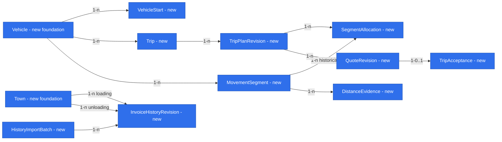

# E01 — Trip entry, quotation and the truck’s next move

Status: **design draft; owner answers applied; not approved for implementation**. Date: 2026-10-26.
Subject: #18. Specification milestone: #22; delivery stories #22–#26 and #28. Companion: [E01 foundations](2026-10-26-e01-foundations.md). Both documents are reviewed together, share one research base and have aligned phases (D33).

## 📝 TLDR

The dispatcher currently quotes with a kilometre rate and plans around each truck’s next unloading. The proposed E01 flow records a truck’s trip, estimates its whole-approach single-trip profitability from dated operational inputs, freezes the accepted quote, and shows next availability and comparable town-pair history. First finish both specifications, then check their synthetic mockup in #21, then build trip entry and quotation as the first clickable phase; later phases complete availability/checks/history (D29).

## Open Questions

Owner decisions D38–D41 now resolve FQ1 (three-case weekend labour), FQ3 (measured last-closed-month fixed costs, no percentage overhead), FQ4 (documented dated source hierarchy) and FQ5’s future monthly split (midnight GPS or time-proportional estimate). See the [foundation answers and remaining gate](2026-10-26-e01-foundations.md#open-questions).

FQ2 (company mail provider and sign-in method, D34/Q21) stays open as instructed and blocks production authentication. New FQ6 asks whether a partial weekend day under the abroad-flat rule is charged in full or prorated; no financial default is chosen. Only that affected case is incomplete pending the answer. Late data after a frozen month remains an E7 question, not a new E01 implementation requirement. Provider thresholds and operational values remain owner-approved external configuration, not repository constants. These documents remain draft and unapproved for implementation.

## 📝 Problem Statement and Scope

The binding record is [product brief](product-brief.md): R02–R05, R07 and R09–R16; R08 refined by R10; active D16–D41. [Backlog](backlog.md) maps #18–#31. The [older pricing review](../analysis/2026-10-26-older-pricing-review.md) supplies failures to avoid, not approved defaults. Existing code and [engineering standards](engineering-standards.md) constrain boundaries and shared helpers; [backward compatibility](../../BACKWARD_COMPATIBILITY.md) protects them.

Include manual trip entry for every truck (#22), future availability (#23), whole-approach allocation and completeness status (#24), single-trip quotation/recorded acceptance (#25), directed-town historical comparison (#26) and its read-only accounting source (#28). Cost-estimate source reads are in E01 under D30; automatic **actual** trip settlement is not. E3/E4 actual costs is the next specification (D37), not a hidden fourth E01 phase.

Exclude chain verdicts, live GPS monitoring, driver app, multi-trip order entry, email extraction, monthly reports, component editing as a general feature, refuelling optimization and other company modules. Manual quote-input replacement is limited to missing-source fallback and is not approval of E5 arbitrary component edits. R01/Q04 remains unresolved: no per-driver consumption enters these calculations. A01/A06 adoption and A03/A05 data accuracy/join coverage remain untested; real dispatcher observation D21 happens only with the first built phase, outside Git/public evidence.

## 📝 Owner Answers and Decision Mapping

- Q1 → D33: two linked documents, shared research, no framework-first phase.
- Q2/Q3 → D36: one accepted order = one truck trip; explicit initial place/time; missing start/approach remains unknown/incomplete.
- Q4 → D36/R02: planner route and country split, editable estimates, odometer optional, evidence check separate.
- Q5 → D35 refining D28: same directed town pair, person-confirmed aliases, no automatic fuzzy merge.
- Q6/Q7 → D30/D36, refined by D39/D40: read-only dated operational inputs; EUR net with original source currency/amount/rate.
- Q8/Q9 → R11/D36: exact intermediates, one final half-up publication; elapsed time and separate vehicle/labour rates; D38 now requires a three-case weekend choice and D39 supplies measured vehicle-day rates.
- Q10/Q11 → D36/D31/R09, refined by D39: revenue, source-covered cost breakdown/result and explicit exclusions, no percentage overhead or verdict; wash always carrier cost, detours included once.
- Q12/Q13 → R12/D32/R10: frozen acceptance/corrections, mandatory loss reason; trip/month views share timestamped segments, no monthly report in E01.
- Q14/Q15 → D28/D34: read-only accounting replica with limited fields; personal company email/membership, mail provider/method open.

D35 records the town decision as a new row rather than editing D28’s old text or reusing brief Q05 (which concerns the co-owner). D30–D34 plus D35–D37 are owner decisions of 2026-10-26 in a T3 thread. Older R06/D17 payment choices are superseded by R09/D31; D29 sequencing is retained.

## 📝 Proposed Solution

The dispatcher selects a truck, enters one trip and exact loading/unloading schedule, answers the mandatory wash question, and requests a quote. The application resolves the predecessor (or explicit first start), routes the whole approach and loaded leg including declared stops, loads dated cost assumptions, and returns either a complete estimated result or the specific missing/conflicting inputs. A missing next load does not make this single-trip quote incomplete. A missing initial approach does.

Acceptance is an explicit action on the shown quote version. It records the order/trip association and immutable input/rate/policy/calculation snapshot; a negative displayed result requires a short reason. There is no accept/negotiate/reject suggestion and no chain result. The next loading search uses where/when this trip ends, without charging a following empty leg to this quote.

After the first phase, a fleet list shows future availability and the kilometre check; historical invoice/entered-trip comparisons follow in Phase 3. Partial E01 rollout is labelled as such: the first clickable phase is not completion of the entire epic or proof of regular adoption. The mockup represents all agreed E01 states before any build.

## 📝 Architecture

`trips` owns trip intent, ordered segment allocations, draft/accepted quote revisions, calculation/acceptance commands and read projections. Minimal `assets` owns vehicle reference/profile; `counterparties` owns Town/Place identity without introducing a customer CRM. The historical invoice adapter owns normalized invoice projections, not accounting totals or trip settlement. Tenant-qualified IDs cross capabilities; services call the owner’s contract rather than writing foreign tables.

Core: `concepts/trips` pure quote/reconciliation functions, `validators/trips` input/output schemas and `ports/trips` scoped repository/route/input contracts. DB: tenant-owned records/migrations/repositories. App/server: explicit use cases and provider adapters, authentication and Awilix bindings using the existing per-request EntityManager. UI: shared string-decimal/date/place/value widgets; page-specific quote/schedule composition stays in app until a second consumer needs it. No new workspace package, module loader or service inheritance layer.

Read providers outside transactions, persist immutable normalized observations and calculation snapshot, then accept atomically with schedule/version checks. A DB read projection may join tenant-scoped tables but must not mutate foreign-owned records. No automatic imports of source rows into business acceptance and no events without an E01 consumer.

### Which foundation primitive is introduced in which phase

| Primitive | First consumer | Phase |
|---|---|---|
| P01 Exact values | Quote | 1 |
| P02 Value evidence | Quote | 1 |
| P03 Dated inputs | Quote | 1 |
| P04 Place identity | Entry, routing | 1 |
| P05 Scoped access | Stored trips | 1 |
| P06 Authentication | Real-data entry | 1 |
| P07 Timed segments | Quote duration | 1 |
| P08 Revision commands | Acceptance | 1 |
| P09 Import identity | Invoice history | 3 |

Phase 2 reuses P01–P08 for availability/checks. Definitions, future backlog consumers and shared research live in the companion. Every primitive ships with its consuming story slice; all nine are not built in advance.

## 📝 Data Model

All following records are proposed, not existing entities. Every business record has tenantId, stable opaque ID, createdAt/actor and optimistic revision where mutable. Monetary snapshots use the foundation’s exact input/output rules; public IDs confer no access. Cross-record constraints include tenant in every reference.

- **VehicleStart:** vehicle, exact start instant, place and source, version. Enter only when the first trip lacks a predecessor. No start + no trip means unknown; no invented free position.
- **Trip:** vehicle, chronological status (`draft|accepted|cancelled`), current plan revision and schedule version; one accepted commercial order reference per trip, no separate generic order engine. Draft is a persisted proposal, not an accepted commercial order. Optional order reference is opaque text, not required customer/contact data.
- **TripPlanRevision:** immutable version of place IDs plus address/town snapshots, loading instant and unloading-end instant, weekendCase, own-wash choice/amount/time, declared stops, segment IDs/allocations and predecessor revision. Latest revision describes the operational plan; earlier accepted versions remain readable.
- **MovementSegment:** vehicle, ordered endpoints, exact UTC start/end, timezone metadata, country-distance parts, load state (`empty|loaded`), kind (drive/wait/load/unload/wash/refuel/rest), planned/observed axis and evidence. Stationary segments have known zero movement, not unknown. Travel country parts sum exactly to the selected travel distance; gaps/overlaps remain explicit. Keep a canonical physical segment identity distinct from a revision’s planned copy: several quote revisions may reference snapshots, but the current distance ledger counts only its single effective segment/version. A terminal empty segment has no trip allocation until the next trip; zero or unknown must be distinguished.
- **SegmentAllocation:** scoped segment → trip revision relation, active allocation/version. Enforce one current owning trip per physical movement segment; split segments at evidenced load/country/temporal boundaries as necessary. Old allocations remain linked to historical revisions, not counted in the current ledger. Cancelling an allocation never deletes its underlying movement evidence.
- **QuoteRevision:** trip plan/predecessor/schedule versions, exact normalized request, selected route and country vectors, dated source observation/policy revisions, calculatedAt, formula/rounding version, missing/conflict list, published revenue/covered-cost/result EUR, fixed-cost source month/category breakdown, uncovered-category list, weekendCase/flat-rate revision, precision and certainty. A complete estimate means required in-scope inputs are present, not that excluded business costs disappeared. Status `incomplete|complete|stale`; no provider can change a stored quote.
- **TripAcceptance:** accepted quote/plan IDs, order reference, actor/time, idempotency receipt, negative-result reason, optional superseded acceptance ID. Only one current effective acceptance per trip; earlier acceptance is never overwritten.
- **DistanceEvidence:** optional odometer/timed movement evidence, interval, reading/value/source/validation status. E01 allows authorized manual odometer evidence; automatic GPS collection belongs to E4. Endpoint readings alone do not establish the distribution of distance at midnight.
- **InvoiceHistoryRevision:** source account/ID/revision, date, net price/source currency, restricted route note, directed town IDs or explicit unmatched state; current projection marker and import batch. No person/customer/payroll fields. Raw route-note access is restricted and sanitized from public logs. Original evidence remains private in authorized DB storage.
- **HistoryImportBatch:** scoped query/cursor bounds, started/completed timestamps, counts, failures and revision keys; never raw operational rows in logs.

New foundation records and company-qualified integrity rules are in the companion. Invoice-history date is a date, not a guessed unloading timestamp. Full endpoints can be stored for entered trips even though history matching is town-level.

All nodes are proposed new data; the existing ORM has no business schema. A predecessor is a same-vehicle, same-tenant revision reference; accepted history is not a cyclic writable ORM graph. The two Town edges represent different role references, never an undirected route.

### Persistence and recovery

Tenant-qualified foreign keys and uniqueness enforce one effective acceptance, source revision deduplication and one active segment assignment. Serialize schedule-affecting writes with a vehicle schedule-row lock/version; lock multiple vehicles in stable ID order if a correction reassigns a truck. Validate predecessor/successor intervals under that lock, not before it. Purely scalar draft CRUD still enforces expected revision. Hard-delete only a never-accepted, unreferenced draft; accepted trips use cancellation/revision commands. Current cancelled segments become unassigned/review-required rather than disappearing.

Introduce additive migrations per phase. Keep accepted snapshots when source/configuration changes; destructive rollback after real acceptance is unsafe. Verify up/down on disposable pre-use data and a forward-recovery/restore procedure for persisted revisions. Do not run migrations during build/render. The implementing PR records new protected routes/schema and backup boundaries.

## 📝 Calculation Contract

### Boundary and routing

A trip starts at its predecessor’s unloading end/place or the confirmed initial start, includes the entire approach, loading and all declared detours/wait/rest, and ends at its own unloading end. The next trip owns its approach. Do not price half legs or a guessed future destination. Chosen vehicle profile and coordinates route through explicit stops; required wash/refuel timings may not overlap loading/travel impossibly. Availability is a planned projection, not a live position or legal driver-hours assurance.

The user enters only the required schedule anchors and declared stops, not a manual second-by-second itinerary. Construct estimated drive intervals from route durations between fixed anchors; retain remaining elapsed time as estimated waiting/unclassified stationary time, never observed rest or legal driver-hours compliance. Fixed stop times take precedence, and impossible travel/stop timing makes the schedule incomplete. Distinguish exactly stored planned timestamps from certainty of the predicted arrival.

Quote resolution seeks measured-journey median evidence only when comparable vehicle/profile/directed endpoints and a coherent country vector are available (older preference, not independently validated here). Otherwise request the configured truck route; a permitted fallback route must be visibly marked with its profile limitations. No car-route result is silently described as truck-safe. All are estimates for this quote. Do not combine the median total with unrelated country averages; select one coherent vector or mark the split missing and require confirmation/recalculation. Provider selection is technical; the companion identifies a candidate and conformance checks, not a production-ready connection.

Dispatcher route edits include country parts and reason; validate sum = approach/loaded total, retain original estimate and revised evidence, and invalidate previous quote. Direct total-only edits without a coherent split make affected fuel/toll cost incomplete. Geocoding/town ambiguity requires choosing an endpoint, never routing to an arbitrary same-named town. Route cache keys include scope/profile/endpoints/stops and versions.

### Inputs and equations

Each country/load-state/time segment supplies distance D, consumption C in litres/100 km, net fuel unit price F and net toll T per km. Estimate litres as `D × C / 100`; fuel cost as `litres × F`; toll as `D × T`. Convert each source amount to EUR using its dated rate direction before exact summation; never round an inverse rate. Planner toll information can cross-check card-measured rates but must not add a second toll charge.

AdBlue retains its owner-set, unit-labelled dated rate and original currency. No source value or operational rate is invented in this document. Planner toll information is a separate visible control beside the card-measured cost, never another charge.

Fixed costs use the external existing monthly per-vehicle division calculation for its **last closed month**, not a revenue percentage. The source supplies separate category-level vehicle-day rates for leasing, insurance, telematics, service package, tank rental, division fixed costs and aggregate vehicle-day driver cost, with closure/revision/month and coverage. It owns the existing monthly-to-day conversion; do not divide payroll or replicate that calculation in E01. Labour is never per person in a quote, fixture, log or repository.

For each covered vehicle category use `vehicleDayRate × elapsedSeconds / 86400`, calculated without intermediate rounding. The denominator is the elapsed 24-hour rate unit; local calendar boundaries still locate weekend intervals, including DST-length days. A category already included in the supplied total must not be charged a second time; verify source category totals/bases and reject an ambiguous mixed vehicle/labour total. Normal labour uses the same elapsed-time conversion of the separate aggregate vehicle-day rate. Both retain the source month; missing required monthly rates or separation makes the quote incomplete.

Weekend choice R13 applies when the trip interval includes a weekend: `homePoland` removes weekend-day labour only (vehicle costs continue); `restAbroad` replaces weekend normal labour with the dated owner-set flat per weekend day; `drivingOn` preserves normal elapsed labour. No selection returns incomplete with “Zapytaj o weekend”. Outside weekend intervals use normal labour; never add both normal and replacement labour for the same time. FQ6 leaves full-day-versus-prorated billing of a partial abroad-rest weekend day unresolved; no implicit minimum or proration is implemented. This is a cost estimate from a dispatcher choice, not GPS-derived driver-hours/legal compliance.

`coveredCost = fuel + toll + AdBlue + ownWash + coveredVehicleFixedCost + adjustedAggregateLabour`.
`revenue = agreedNetFreight`; wash never creates revenue.
`resultWithinCoverage = revenue - coveredCost`.

Show the division fixed-cost category/coverage separately where present, so the earlier overhead presentation request remains explainable, but do not add an independent overhead amount or the older revenue percentage. Categories absent from the monthly calculation display “Nie uwzględniono” / `notIncluded`, never an invented percentage or numeric zero. Explicitly labelled coverage/exclusions accompany the result; do not call a source-covered result complete economic profit when known categories are excluded. An intentionally uncovered category is different from an unavailable required provider value: the latter makes the quote incomplete. No markup target, cash/full/chain threshold or automatic verdict is implemented.

Publish rounded aggregate values using R11. A displayed rounding reconciliation line explains differences between summed displayed components and the exact aggregate; comparisons and the loss-reason check use the rounded `resultWithinCoverage` shown to the dispatcher. Source estimates or allocation estimates propagate to the result.

D40/R15 fixes the source/date hierarchy, with full details in foundation P03: country card fuel price from the last 14 days, litre-weighted over the last three refuelling days; then dated public price minus median same-day card/public discount; then manual country price valid no more than 14 days; else a named missing country price. Central-bank trip-date FX falls back to the last published rate on weekends, holidays or future dates, retaining its date and estimated status for future use. Own-vehicle CAN country/load-state consumption precedes the corresponding fleet average when approved sufficiency is met. Tolls use country card rate/km for the last closed month. Thresholds, selected sample periods, source coverage and rate direction remain versioned owner-approved provider configuration, never hidden constants. Do not use future transactions/publications when estimating a future trip or silently invert a rounded FX rate. Price resolution and mixed-date/country segments retain the evidence behind each estimate.

Do not port tank-half-full assumptions, cheapest-country procurement or physical fuel-purchase planning: purchased fuel and costed consumed litres are different concepts.

### Revision lifecycle

Draft trip edits create new plan/segment revisions; quoting creates a complete or incomplete immutable QuoteRevision for that plan. Further edits, changed schedule/predecessor or requested input refresh make the previous unaccepted quote stale. Accept verifies the exact quote ID and expected plan/schedule/policy-selection versions; rejects incomplete/stale/conflicting quotes. A retried acceptance with the same key/payload returns the same acceptance; a changed payload with the key conflicts.

Accepted snapshots stay immutable even when a source changes. Correction starts from the accepted record into a proposed revision; on explicit corrected acceptance record supersession and reason. Affected unaccepted successor quotes become stale. Accepted successors retain their historical quote and are flagged `scheduleReviewRequired`; do not silently recompute their accepted figures or present their current projection as verified. A schedule edit introducing overlap is rejected until explicitly corrected; the recorded historical disagreement remains inspectable. Cancellation similarly preserves evidence and invalidates dependent draft quotes.

## 📝 API Contracts

All endpoints are proposed, company-scoped and use the existing envelope. Strict Zod DTOs reject unknown fields; financial values are canonical strings. IDs, bounded text, date intervals and page limits are validated. Tenant/actor/source-trust/status/totals are server-controlled. Domain errors map to existing `VALIDATION_ERROR`, `CONFLICT`, `FORBIDDEN`, `NOT_FOUND`; HTTP never exposes SQL/provider bodies. Return quote incompleteness as successful domain data, not a fabricated zero result.

Reference CRUD (`/api/assets/vehicles`, `/api/counterparties/places`) and draft trip CRUD (`/api/trips`, `/api/trips/:id`) use `makeCrudRoute`; export only allowed methods. Draft create/update delegates to scoped transactional services enforcing scheduling/version rules. Use a backwards-compatible shared `If-Match`/expected-version facility for PATCH/DELETE before adding versioned consumers; do not bypass the factory. Protected accepted records cannot be changed through generic PATCH/DELETE. Standard list filters must be explicit typed extensions of the existing bounded builder, not unchecked query forwarding.

Core request shapes (descriptive contracts; implementation derives types from Zod):

- `TripDraftInput`: `vehicleId`, `loadingPlaceId`, `unloadingPlaceId`, `loadingAt`, `unloadingEndAt`, timezones/offsets, `wash: {kind:"none"}|{kind:"ours",amount:MoneyInput,at,placeId}`, `stops`, optional-until-quotation `weekendCase: "homePoland"|"restAbroad"|"drivingOn"`, segment schedule and optional opaque `orderRef`. Required weekend choice is validated against elapsed time at quotation, without preselecting a case. A date/time is required on save; unknown starting context may be saved but explicitly blocks a complete quote. `MoneyInput` includes decimal-string amount, source currency and net basis.
- `POST /api/trips/:id/route-estimates`: command `{expectedPlanRevision, expectedScheduleVersion}`; server resolves scoped endpoints/profile/stops and returns `{routeRevisionId, segments, distanceByCountry, evidence, limitations}` or missing fields. Does not create a route using arbitrary outbound URLs supplied by the client.
- `POST /api/trips/:id/quotes`: `{expectedPlanRevision, expectedScheduleVersion, routeRevisionId, allowedSourceGapInputs?, requestKey}`; server selects dated sources and computes, never accepts client totals. Response `{quoteId, state:"complete"|"incomplete", missingFields, conflicts, planRevision, scheduleVersion, values, freeAt, freePlace, evidenceRefs}`. Incomplete values may show known partial components but no complete final result.
- `POST /api/trips/:id/acceptances`: `{quoteId, expectedPlanRevision, expectedScheduleVersion, requestKey, lossReason?}`; returns acceptance/revision IDs. Trimmed loss reason required if rounded result < 0; limit 500 characters, instruct no names/personal data. Missing, stale and replay payload conflicts produce safe field/conflict responses.
- `POST /api/trips/:id/corrections` and `/cancellations`: scoped command with expected version/request key/reason; creates a proposal or cancellation record, never rewrites an accepted quote. Correction acceptance uses the normal acceptance command with the prior acceptance reference.
- Phase 2 reads: `GET /api/trips/availability?offset&limit` and `GET /api/trips/:id/kilometre-check`; authorized read operations via `apiHandler`. Return source/certainty, free location/time, open-approach known/unknown values and `verification:"verified"|"notVerified"|"conflicting"` with named implicated trip IDs/intervals. No live GPS field.
- Phase 3 reads: `GET /api/trips/:id/similar?offset&limit`; pair comes from the scoped plan, not client tenant/name filters. Rows distinguish `invoice` and `enteredTrip`, date, direction, estimated source price/currency, optional EUR projection only with dated FX; `result`/`emptyKm` absent for invoice rows. Import and town-mapping commands below use `apiHandler`.

Vehicle initial-start update, town-alias confirmation, source-gap input and invoice-import start are explicit commands with expected version, request key and permission. Invoice import accepts a bounded date range/cursor only; registered server configuration fixes the source/account/field allowlist. No client-supplied SQL/host/password, unrestricted filter or payroll view. A cancellable operator-triggered job uses a durable batch record/cursor and idempotent chunks; no queue framework is needed for this single consumer. Timed-out job resumes from the last committed chunk, not a second concurrent full import.

## 📝 UI/UX

No accepted prototype exists yet; #21 produces one after specification decisions, using synthetic data. Tailwind/shadcn and existing form/table/feedback are mandatory. Foundation widgets extend `CrudForm` through typed slots; no parallel financial form infrastructure. Polish messages live in the current translation module.

Phase 1 screen flow: select truck → enter start if needed → enter loading/unloading places and exact times → explicitly choose “Bez mycia” or “Nasze mycie” with amount/date/place → review routed approach/loaded distances and country split → quote → inspect sources/missing inputs → accept with loss reason when needed. Show next free place/time alongside result. Missing wash has no preselected default. Changing fields preserves input, marks old quote stale and makes acceptance unavailable until recalculated. Pending/cancel/network/conflict states use shared feedback and retain edits.

Phase 2 fleet view is a paginated `DataTable` with truck, next-free place/time and open-approach status; trip detail exposes sequence and implicated gap/overlap. “Niezweryfikowane” is distinct from “Zgodne” and “Brak danych”; missing odometers/GPS never yields a green proof badge. A known last unloading can be shown as planned availability without pretending it is live presence.

Phase 3 history appears beside the quote with loading town → unloading town, date and source price. Invoice rows say “Szacunek”; they show no invented result/empty distance. Entered-trip rows explicitly identify quote-derived planned result/empty km until the next E3/E4 specification supplies actuals. Do not present plans as settled historic profit. Display no history versus source unavailable versus unmatched places differently; all allow the standalone quote to proceed. Prices in unlike currencies are not silently ranked as EUR.

All numeric rows use `ValueWithSource`, including distance/consumption/dates relevant to the figure; exact-source details are accessible without relying on color. Keyboard/focus/error associations/dirty navigation and narrow layouts are validated with the changed flows; small screen presentation may stack field groups without adding a new navigation system. Do not design a new visual identity here.

## 📝 Empty Kilometres and Month Boundary

Trip allocation and completeness are different checks. Plan topology can detect duplicate assignment, predecessor mismatch and schedule overlap; actual kilometre completeness requires a covered evidence interval. With validated monotonically increasing odometers at interval boundaries, reconcile empty + loaded assigned distance plus open approach against measured delta at the approved precision; detect gaps/overlap and show implicated trips/evidence. A measured total alone cannot validate every intervening leg; verification is scoped to the interval/coverage actually supported. Missing evidence remains notVerified, not zero or passed. Corrected/reset/contradictory odometers require review rather than negative distance arithmetic.

After last unloading, an entered terminal empty segment stays open, with dates and certainty; unknown travel is explicitly unknown. When a next trip arrives, the segment’s current allocation changes to that trip exactly once, even across months. It never changes the preceding accepted quote. Cancelled/reordered trips may leave segments unassigned/review-required and invalidate unaccepted dependent quotes.

D32’s monthly view is a future consumer: preserve exact planned/observed segment timestamps, source distances/cost bases and versions now. Interpret “24:00 last day” as `[monthStart,nextMonthStart)` in the configured company reporting timezone, resolving instants in UTC. For future E7, D41/R16 selects the GPS odometer reading at local midnight as “GPS measurement”; when GPS is missing, split total segment distance in proportion to elapsed time and label it “estimate: time-proportional split”. Never leave a hole in the month figures. This fallback is an estimate, not measured completeness, and late data after freezing remains Q24 for E7. E01 still only stores the exact segment timestamps and source context; it does not collect GPS, execute the monthly split, generate the monthly report, freeze a month, invent observed movement from the planner or double-count a later trip assignment in E01. Trip-result sums and a future frozen month sum are different projections of the same segment evidence, not two additive charges.

## 📝 Invoice History (#28 → #26)

Read the already-available accounting replica (owner-provided availability, not a connection tested in this run), with a dedicated read-only identity/view permitting only invoice date, price, currency, source ID/revision and route note. Never read payroll tables or copy accounting entities into product code. A correction marker/revision must be supplied or derived from allowed row content to make replay deterministic; source deletion is not inferred from absence in a partial import.

Parser version, source revision and confirmed directed town mapping produce a new projection. Normalize spelling to candidate keys; a person confirms aliases and ambiguous place context once. Unknown country is preserved, not guessed. Import rows with unparseable direction, multiple possible town pairs, invalid net/currency or disputed corrections enter an explicit review state and contribute to aggregate unmatched counts, not fake similar trips. Duplicate correction replays do not duplicate history.

Invoice rows show date/invoiced price as estimated context per D28, not an actual trip-cost result. Entered-trip history starts empty and can provide recorded quote-based plan results and empty kilometres labelled as plan; actual results await E3/E4. Reverse direction is excluded. Deduplicate an invoice and entered trip only when a verified explicit link exists; do not infer a join from same date/towns or add their prices together. No source records or real addresses enter fixtures, screenshots or logs.

## 📝 Edge Cases & Failure Scenarios

Acceptance scenarios to verify with synthetic fixtures, beyond standard CRUD:

1. No trips/start → unknown availability; missing first approach → incomplete quote.
2. A then B → B owns the entire A-unload-to-B-load approach; A unchanged.
3. No next load → current single-trip quote still valid; open approach separate.
4. Missing wash or wash amount/date → named errors, no default no-wash.
5. Carrier wash increases cost only; legacy client-paid wash input rejected.
6. Missing loading/unloading exact time or reversed schedule → validation error.
7. DST skipped/ambiguous time → explicit rejection/offset choice; company timezone retained.
8. Future/weekend/holiday FX → last published central-bank rate with its date and estimate status for future use; source data never leaks from after quote as-of.
9. Source outage/staleness/conflict → retain inputs, follow the approved source hierarchy or list missing fields; no fabricated complete acceptance.
10. Same named towns in different regions, spelling aliases and reversed routes → mapping review/exclusion.
11. Median/country-vector mismatch or edited totals not summing → incomplete fuel/toll calculation.
12. Detour crosses country/date → all legs/time priced once under matching dated inputs.
13. Odometer absent → notVerified, not failed and not passed; conflicting/reset readings → review.
14. Terminal approach crosses month/year → same timestamped segment retained and allocated once later; E7’s GPS/proportional rule is recorded but no monthly report created.
15. New predecessor/reordered/overlapping trip → reject invalid schedule, stale affected unaccepted quotes, flag accepted successors.
16. Double-click/retried accept → same receipt; same key/different payload → conflict.
17. Concurrent quote acceptance and schedule edit → one wins by version/lock, other conflicts without partial writes.
18. Correct/cancel accepted trip → append revision, preserve accepted snapshot and source refs.
19. Rounded result negative/zero and half-up ties → loss reason follows visible rounded result, never an invisible threshold.
20. Invoice correction/replayed/partial batch → one current projection, prior revision retained, no deletion by absence.
21. No similar trips/unmatched routes/provider failure → distinct states, single-trip quote still usable.
22. Foreign tenant vehicle/place/segment/quote/evidence/receipt/source/account → denied in DB and server read paths.
23. Shared/unlisted company address, revoked member, reused link, CSRF → no E01 data access or mutation.
24. Decimal string through input/ORM/JSON/UI → no number coercion or independent intermediate rounding.
25. Weekend elapsed time without a choice → incomplete “ask about the weekend”; homePoland/restAbroad/drivingOn retain vehicle cost and apply the distinct labour rule once. Partial abroad-flat day waits for FQ6.
26. Last closed monthly cost source → preserve vehicle/month/category closure revision; excluded category says notIncluded, required unavailable rate makes quote incomplete, no percentage surcharge.
27. Fuel hierarchy → correctly litre-weight selected days, median matched discounts and manual-age boundary; unavailable discount does not mean zero, and all absent branches name the country.
28. Own-vehicle CAN below configured sufficiency → fleet country/load-state fallback with source/period, never per-driver data; toll source remains last-closed-month cards and planner toll is control only.

## 📝 Synthetic Calculation Examples

These examples use only invented EUR net decimal strings and abstract places A/B/C, not executed application tests or company rates. The synthetic last-closed-month provider supplies a vehicle-day rate "72.000000" and aggregate labour vehicle-day rate "48.000000" with all fixture fixed-cost categories covered. No separate overhead exists. Elapsed time is 2 hours outside a weekend, so vehicle cost is "6.00" and labour "4.00". Toll "0.100000"/km, fuel "1.000000"/litre and AdBlue "0.010000" per fuel litre are synthetic inputs only.

- Approach 20 km at "10.000000" l/100 km plus loaded 80 km at "20.000000" gives "18.000" litres. Fuel "18.00", toll "10.00", AdBlue "0.18", vehicle "6.00", labour "4.00", no wash: coveredCost "38.18". Freight "60.00" gives resultWithinCoverage "21.82". An unknown future approach after unloading changes none of this quote.
- Add carrier wash "5.00" within that same 2-hour boundary: coveredCost "43.18", revenue "60.00", result "16.82". Detour km/time trigger recomputation, not just an added wash amount.
- Freight "30.00" with the first example gives result "-8.18" and requires a reason to accept. A deliberately excluded category is labelled notIncluded beside this coverage-limited result. Missing required monthly cost input instead makes the result incomplete; it is not a zero-rate fallback.
- With the same variable cost "28.18" but exactly one full 24-hour weekend day and no weekday overlap, vehicle cost is "72.00" in all three modes. HomePoland labour "0.00" gives coveredCost "100.18"; restAbroad with a synthetic dated flat "24.00" gives "124.18"; drivingOn normal labour "48.00" gives "148.18". This proves replacement rather than double charging; it does not settle partial-day FQ6 or production configuration.
- Synthetic fuel-card example on three eligible refuelling days within the 14-day window: litres "10", "20", "30", corresponding net amounts "10", "40", "60" give weighted price `110/60`, published "1.833333", not the unweighted average of the three prices. Preserve the exact ratio in cost calculation until R11 publication.
- Half-up publication of exact money "1.005" gives "1.01" and "-1.005" gives "-1.01". Exact components "0.004" + "0.004" publish aggregate "0.01" while each displays "0.00"; show a "0.01" rounding reconciliation, never sum displayed zeros into a zero total.

Before implementation validate fixture explanations against owner policies and the approved external provider configuration; extend with full/missing fuel fallback branches, net/FX direction, weekday/weekend boundaries, partial-day blocked state, repeating division and source conflicts. Historical review examples with client-paid wash, half legs or percentage overhead remain historical comparisons only.

## 📝 Risks & Impact Review

Provider/source readiness and quote latency are unverified. Synthetic adapter fixtures cannot prove live country coverage, net data semantics or route legality; an authorized bounded read-only readiness check must precede real-data rollout. Missing sources block only the affected complete calculation; unavailable history never blocks a valid standalone quote. Existing operational consumption quality is not validated by D30; measure it later without per-driver inference.

Financial precision, policy choice, immutable history, email binding and place aliases are durable contracts. No code, migration, paid provider registration, credential access, production query, PR or merge is part of this specification run. New APIs/exports/schema enter protected-contract documentation in their implementing phase. Keep actor reasons and route notes private, constrain lengths/permissions and follow an approved retention policy before storing extra personal data; do not add personal contacts.

## 📋 Phasing

- **Phase 1 — first clickable trip entry + quote (#22 and first #25 slice):** secure personal-account/company access, minimal vehicle/place references, initial start, exact schedule/segments, routed full approach, dated input estimate, mandatory carrier wash, visible result/free place/time and frozen acceptance plus minimal correction/cancellation safety. This phase includes only the minimal dependencies from #23/#24 needed for correct quotation, not the full fleet/check/history screens. D21 observes a real offer with this running phase; no pre-build dispatcher session gates it.
- **Phase 2 — fleet availability + kilometre check (#23/#24):** chronological fleet projection, explicit open approach and evidence-scoped gap/overlap/coverage review. It displays existing Phase 1 review-required states; it does not reimplement correction or successor invalidation. No GPS importer or monthly report.
- **Phase 3 — similar trips + invoice reader (#28/#26):** bounded read-only import, confirmed town aliases, correction replay and history beside quote. This completes E01 when all criteria below pass; then specify E3/E4 under D37.

Phase 1 correction/cancellation is retained deliberately for the first real-data use: manual entry during a call can contain a mistaken accepted date, truck or amount, and the next quote already depends on that accepted unloading. The minimum safe operation is an explicit append-only correction/cancellation using the same entry/acceptance controls and a successor review warning. Locking users into a known wrong acceptance until Phase 2, or repairing it by DB edits, would violate R12 and undermine D21. No bulk correction workspace, historical comparison UI or automatic repricing is included; the richer fleet visibility comes in Phase 2. This is a safety dependency of the first real-data quote, not a separately deployable new capability.

## 📋 Implementation Plan

Precondition: owner approves both designs and resolves the policies blocking the affected step; #21 synthetic mockup traces all phases/states to both documents. These are future implementation steps, not work executed in this run. Each step preserves the existing app; only complete phase outcomes are presented as released capability.

**Phase 1**

1. **1.1 Entry and access:** add minimum tenant/member/vehicle/place/start/trip/segment persistence and authorized trip entry composed with shared UI/API; introduce P04–P08 only for this consumer. Choose approved FQ2 library/method first. Verify two-tenant FK/query attacks, shared-email denial, chronological validation, empty/unknown state, migrations/restore and entry screenshots. Existing app remains operable while unfinished quotation is unavailable.
2. **1.2 Route and input preview:** add P03 adapters and P02/P01 value contracts with actual routed estimate consumer. Validate synthetic country splits, stops, source-date/currency semantics, missing/conflict/stale states, cancellation and route overrides. No complete financial result is exposed yet; preserve entry and user edits. Readiness must not access real data without separate authorized configuration.
3. **1.3 Complete quotation:** implement pure R11 formula contract and evidence breakdown, with P01/P02 value display and source-gap controls. D38–D41 policies now apply; approved provider configuration and independent synthetic expected results are required. FQ6 blocks only a partial-day abroad-flat case until resolved. Validate exact/repeating decimals, money/quantity PostgreSQL round trips, whole approach, detours and incomplete results. Browser screenshot records quote and missing-input paths.
4. **1.4 Acceptance and revisions:** add idempotent transactional acceptance, loss reason, schedule lock/version, stale quote and correction/cancellation behavior. Prove one current segment assignment under concurrent next-trip/accept/edit requests here, together with duplicate-receipt replay, audit rollback and accepted-successor review state; no silent overwrites. Correction/cancellation uses the same entry form and one explicit reason/confirmation, without a new management screen. Screenshot successful, negative and conflict flows.
5. **1.5 Phase gate:** run configured commands and browser integration evidence; verify trip entry → quote → accept works in one flow with source labels and next availability. Record D21 observation privately in the authorized deployment when arranged; repository evidence remains synthetic and does not claim regular adoption.

**Phase 2**

6. **2.1 Fleet availability:** build paginated future-free projection via shared DataTable, no live GPS; include unknown truck and open-approach states. Verify the read projection displays Phase 1’s existing predecessor/successor review flag and applies authorization; screenshot all changed screens.
7. **2.2 Kilometre check:** add scoped optional distance-evidence entry and allocation reconciliation; cover verified intervals, notVerified, missing/conflicting/reset readings, gaps/overlaps and month-crossing open segments. Consume the Phase 1 assignment invariant; test new measured-distance coverage/gap/overlap logic and its evidence updates without duplicating the acceptance race implementation. Run full gate and screenshots; do not implement monthly closure.

**Phase 3**

8. **3.1 Restricted history reader:** add P09 batch/cursor/dedup records and explicit read-only replica adapter over approved columns. Use synthetic correction/replay/outage/invalid-currency/unmatched-route tests; no payroll queries. Town aliases use P04 and operator review, not fuzzy auto-merge. Verify restart/cancel preserves exactly one current source revision and does not infer deletions.
9. **3.2 Similar-trip panel and epic gate:** query same directed town pair, distinguish invoice context from entered plan results, omit invoice result/emptyKm, show unavailable/unmatched/empty separately. Verify reverse exclusion, currency/date/provenance, two-tenant history isolation and screenshots. Run full gate, map all story criteria to evidence, then mark E01 delivered only after those checks and owner approval; actual post-trip costs remain the next specification.

## 📝 Acceptance and Validation Matrix

- #22: entered truck trip is chronological with exact dates, first start and wash details; negative cases reject missing dates and invalid scheduling. Evidence: 1.1/1.4 integration plus screenshot.
- #23: planned free place/time at unloading end, unknown no-trip/no-start, open approach and no live GPS. Evidence: 1.3 then 2.1 browser/DB checks.
- #24: full approach belongs to successor, one current segment assignment, gap/overlap references and open terminal handling; evidence absent means notVerified. Evidence: 1.4 assignment/race checks; 2.2 measured-coverage pure/persistence/browser checks.
- #25: required wash/dates, whole-approach exact quote, source/certainty/date, EUR net, immutable accepted snapshot, no verdict and negative reason. Evidence: 1.2–1.5 calculation/provider/DB/browser checks.
- #26/#28: directed town matching with confirmed aliases, invoice date/price estimate only, entered plan result/emptyKm labelled, reverse excluded and empty/outage nonblocking. Evidence: 3.1–3.2 adapter/DB/browser checks.
- R10/D32: exact timestamped segment storage and stable open-approach allocation are verified in E01; monthly completeness/freeze correctness is explicitly unimplemented and must be proved in E7, using D41/R16; late frozen-month data remains an E7 decision.
- Security/foundations: every entry path and nested reference rejects foreign scope; revisions/receipts/source updates survive races; exact values and evidence persist without number conversion; all new pages/flows leave integration-evidence screenshots.

Required implementing checks: `pnpm lint`, `pnpm typecheck`, `pnpm test:coverage` (100% statements/branches/functions/lines over the mandated roots), `pnpm build` and `pnpm test:integration` (disposable PostgreSQL, agent-browser, screenshots). A passing document check is not any of those checks or approval of this draft.
