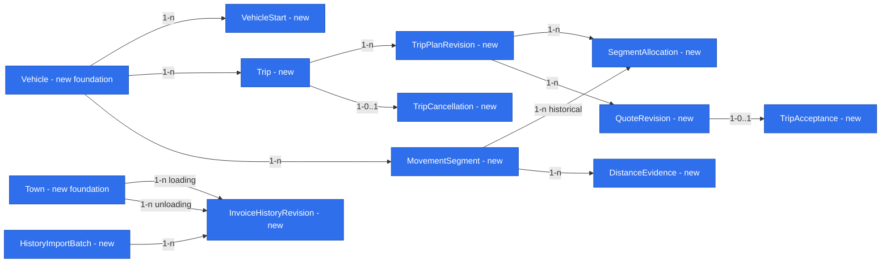

# E01 — Trip entry, quotation and the truck’s next move

Status: **ready for owner approval; not approved and not implemented**. Date: 2026-10-26.
Subject: #18. Specification milestone: #22; delivery stories #22–#26 and #28. Companion: [E01 foundations](2026-10-26-e01-foundations.md), which defines the shared rules `FIN-*`, `EV-*`, `SRC-*`, `ROUTE-*`, `PLACE-*`, `AUTH-*` and `TIME-*` referenced here. Binding: [product brief](product-brief.md) R02–R20 and active D16–D58; [backlog](backlog.md) maps #18–#31. The [older pricing review](../analysis/2026-10-26-older-pricing-review.md) lists failures to avoid, not defaults.

## 📝 TLDR

The dispatcher records each truck’s trip, gets a whole-approach single-trip profitability estimate from dated inputs, accepts and freezes the shown quote, and sees where and when the truck becomes free and comparable past trips. Build order (D29): synthetic mockup in #21, then Phase 1 trip entry and quote, Phase 2 availability and kilometre check, Phase 3 similar trips from invoice history.

## 📝 Scope

Include manual trip entry for every truck (#22), future availability (#23), whole-approach allocation and completeness check (#24), single-trip quotation and recorded acceptance (#25), directed-town historical comparison (#26) and its read-only accounting source (#28). Quote inputs are read under D30; actual trip settlement is E3/E4, the next specification (D37).

Exclude chain verdicts, live GPS, driver app, multi-trip order entry, email extraction, monthly reports and month closure (E7), general component editing (E5), refuelling optimization, per-driver consumption (Q04 open) and other company modules. Manual inputs only fill missing sources (SRC-7, D50): what the telematics, fuel-card and accounting sources hold is read, never re-typed. Do not port tank-half-full assumptions, cheapest-country procurement or fuel-purchase planning: purchased fuel and costed consumed litres are different quantities.

## 📝 User Flow

The dispatcher selects a truck, enters one trip with exact loading and unloading times and the agreed freight, answers the mandatory wash question and requests a quote. Several drafts for the same truck may be quoted side by side before one is accepted. The server resolves the predecessor (or the explicit first start), routes the whole approach and loaded leg through declared stops, loads dated inputs, and returns either a complete estimate or the specific missing/conflicting inputs. A missing next load does not make the quote incomplete; a missing initial approach does.

Acceptance is an explicit action on the shown quote version; it freezes inputs, rates, policy and calculation version. A negative rounded result requires a short reason. There is no accept/negotiate/reject suggestion and no chain result. The next free place and time is the end of unloading; a following empty leg is never charged to this quote.

## 📝 Architecture

- `trips` owns trip intent, plan revisions, segment allocations, quote revisions, acceptance/correction/cancellation commands and read projections. Minimal `assets` owns vehicles; `counterparties` owns towns and places (no CRM). The invoice-history adapter owns normalized invoice projections only. Capabilities exchange tenant-qualified IDs and call each other’s contracts, never write foreign tables.
- Core: `concepts/trips` pure quote and reconciliation functions, `validators/trips` Zod schemas, `ports/trips` repository/route/input contracts. DB: tenant-owned records, migrations and repositories. App/server: use cases, provider adapters, authentication and Awilix bindings on the per-request EntityManager. UI: shared widgets from the companion; quote and schedule composition stays in app until a second consumer exists. No new package, module loader or service hierarchy.
- Read providers outside transactions, persist normalized observations and the calculation snapshot, then accept atomically under schedule/version checks.
- Primitive-to-phase mapping: the single table in the companion (P01–P08 in Phase 1, P09 in Phase 3).

## 📝 Data Model

All records are proposed. Every business record has `tenantId`, a stable opaque ID, `createdAt`, actor and an optimistic revision where mutable; every reference includes tenant (AUTH-1).

- **Vehicle** (foundation) — one fixed tractor and tank-trailer set with one route profile and one rate set; the list is read from the telematics source, manual creation only fills a gap. Moving trailers between tractors is later.
- **VehicleStart** — vehicle, exact start instant, place, source, version. The only start-up input per truck: where and when it becomes free from its current work. No history or current order is entered. No start and no trip means unknown.
- **Trip** — vehicle; status `draft|accepted|cancelled` (drafts are alternatives, DRF-1; a lost offer stays a draft or is discarded, no extra status); current plan revision; schedule version; `scheduleReviewRequired` flag; optional opaque `orderRef` (no customer data). One accepted commercial order per trip.
- **TripPlanRevision** — immutable: place IDs with address/town snapshots, loading instant, unloading-end instant, agreed net freight (`MoneyInput`), `weekendCase`, wash choice/amount/time, declared stops, segment references, predecessor revision.
- **MovementSegment** (TIME-1) — vehicle, ordered endpoints, exact UTC start/end, timezone metadata, per-country distance parts, load state `empty|loaded`, kind `drive|wait|load|unload|wash|refuel|rest`, planned/observed axis, evidence. Stationary segments have known zero distance. Country parts sum exactly to the segment distance. A canonical physical segment is distinct from the planned copies referenced by plan revisions; the distance ledger counts only the current effective version.
- **SegmentAllocation** — segment → trip revision, active/version. Exactly one current owning trip per physical segment; split at evidenced load/country/time boundaries. Historical allocations stay linked to old revisions and are not counted.
- **QuoteRevision** — immutable: plan revision, predecessor and schedule versions, normalized request, route revision and country vectors, source observation and policy revisions, document references, `calculatedAt`, formula/rounding version, missing/conflict list, published revenue, covered cost and result in EUR, fixed-cost source month and category breakdown, `notIncluded` categories, `weekendCase` and flat-rate revision, certainty. Status `incomplete|complete`. Staleness is derived, never stored: a quote is stale when its plan revision, schedule version or predecessor version differs from the trip’s current ones.
- **TripAcceptance** — accepted quote and plan IDs, `orderRef`, actor, time, loss reason, optional superseded acceptance ID, `requestKey` and payload hash (TIME-3). One current acceptance per trip; earlier ones are never overwritten.
- **TripCancellation** — trip, actor, time, reason, `requestKey` and payload hash.
- **DistanceEvidence** (Phase 2) — odometer and timed movement observations read from the telematics source for every truck: interval, reading, source revision, validation status. Never entered manually. Endpoint readings alone do not locate distance at midnight.
- **InvoiceHistoryRevision** (Phase 3) — source account/ID/revision, date, net price and source currency, restricted route note, directed town IDs or explicit unmatched state, current-projection marker, import batch. No person, customer or payroll fields.
- **HistoryImportBatch** (Phase 3) — bounded query/cursor, timestamps, counts, failures, revision keys; never raw rows in logs.

A predecessor is a same-vehicle, same-tenant revision reference, not a writable ORM graph. The two Town edges are different roles, never an undirected route.

**Persistence and recovery.** Tenant-qualified keys and uniqueness enforce one current acceptance, source-revision deduplication and one active segment allocation. Schedule-affecting commands lock the vehicle schedule row and check its version; lock several vehicles in stable ID order; validate predecessor and successor intervals under the lock. Hard-delete only a never-accepted, unreferenced draft; accepted trips change only through correction or cancellation. Cancelled segments become unassigned and review-required, not deleted. Migrations are additive per phase; verify up/down on disposable data and a restore procedure before real data; never migrate during build or render.

## 📝 Calculation Contract

### Trip boundary and route

- **BND-1 Boundary.** A trip starts at its predecessor’s unloading end and place, or at the confirmed initial start. It includes the whole approach, loading, all declared detours, waits and rests, and ends at its own unloading end. The next trip owns its approach. No half legs and no guessed future destination.
- **BND-2 Schedule.** The dispatcher enters only schedule anchors and declared stops. Drive intervals come from route durations between fixed anchors; remaining elapsed time is estimated waiting/unclassified time, never observed rest or legal driver-hours compliance. Fixed stop times take precedence; impossible timing makes the schedule incomplete. Availability is a planned projection, not a live position.
- **BND-3 Route.** Route through the vehicle’s truck profile and explicit stops (ROUTE-1). Optionally prefer a measured-journey median when comparable vehicle, directed endpoints and a coherent country vector exist; never combine a median total with unrelated country averages. Pick one coherent vector or mark the split missing. All route figures are estimates.
- **BND-4 Route edits.** A dispatcher edit includes country parts and a reason; validate that parts sum to the approach/loaded total, keep the original estimate beside the revision and make the previous quote stale. A total-only edit without a coherent split makes fuel and toll incomplete. An ambiguous geocoding/town result requires choosing an endpoint (PLACE-3). Route cache keys include scope, profile, endpoints, stops and versions.

### Cost formulas

For each country/load-state/time segment: distance `D`, consumption `C` in l/100 km (SRC-3), net fuel price `F` (SRC-1), toll `T` per km (SRC-4).

- `litres = D × C / 100`; `fuel = litres × F`; `toll = D × T`; `adBlue` per SRC-6. Convert each source amount to EUR with its dated rate (SRC-2) before summing.
- **Vehicle costs:** for each covered category (SRC-5), `vehicleDayRate × elapsedSeconds / 86400` over the whole trip interval, including weekends.
- **Normal labour:** `driverDayRate × elapsedSeconds / 86400`, adjusted by WKD-1.
- `coveredCost = fuel + toll + adBlue + ownWash + coveredVehicleCost + labour`
- `revenue = agreedNetFreight` converted to EUR with SRC-2 (wash never creates revenue, R09). Missing freight makes the quote incomplete with “Brak ceny frachtu”: costs are shown, the result is not.
- `resultWithinCoverage = revenue − coveredCost`

Show categories absent from the monthly configuration as “Nie uwzględniono” (`notIncluded`), never a percentage or zero. A missing required rate makes the quote incomplete. Do not call a coverage-limited result complete economic profit. No markup target, threshold or verdict. Publish per FIN-3; estimates propagate (EV-3).

- **WKD-1 Weekend labour (R13, D38, D42, D43).** This is the only full statement of the rule; everything else refers to it.
  - **Calendar.** The labour weekend is `[Saturday 00:00, Monday 00:00)` Europe/Warsaw, whatever the truck’s location or border crossings. Resolve each boundary with its actual DST offset, so a DST weekend lasts 47 or 49 hours but is still two calendar days. Use half-open trip intervals: an endpoint exactly at a day boundary does not touch the next day.
  - **Required choice.** If the trip interval overlaps that weekend, the quote needs `weekendCase`. Without it the quote is incomplete with “Zapytaj o weekend”. There is no default.
  - **`homePoland`:** no labour for the weekend overlap; vehicle costs continue.
  - **`restAbroad`:** the weekend overlap’s normal labour is replaced by the owner-set dated flat amount (`PolicyRevision`) for every weekend calendar day the trip touches, the full amount however short the overlap.
  - **`drivingOn`:** normal elapsed-time labour.
  - Never charge normal and replacement labour for the same time.
  - **Scope.** One `weekendCase` applies to every weekend in the quote; mixed cases are not expressible in E01.
  - **Snapshot.** Store the calendar policy version and flat-rate revision in the quote. This is a cost estimate from the dispatcher’s answer, not driver-hours compliance.

### Revision lifecycle

- **DRF-1 Drafts are alternatives (D54).** Drafts do not occupy the schedule: a draft's predecessor is the vehicle's last accepted trip, and overlap is checked only between accepted trips. Several drafts of one vehicle from the same predecessor can be quoted and compared side by side (freight, covered cost, result, result per day and per km, next free place and time), sortable, with no recommendation (D22). Accepting one makes the other drafts from that predecessor stale (derived). Comparing one offer across trucks is later: enter it as a draft on each truck.
- Draft edits create new plan and segment revisions; quoting creates an immutable `complete` or `incomplete` quote for that plan. Further edits, a changed predecessor or schedule, or a requested input refresh make the previous unaccepted quote stale (derived).
- Accept checks the exact quote ID and the expected plan and schedule versions; it rejects incomplete, stale or conflicting quotes. Replay follows TIME-3.
- Accepted snapshots never change when sources change.
- **Correction:** starts from the accepted record as a new proposed plan revision; its acceptance records the superseded acceptance and a reason.
- **Cancellation:** keeps all evidence and invalidates dependent draft quotes.
- **Effects on later trips:** after a correction or cancellation, unaccepted successor quotes become stale; accepted successors keep their quote and get `scheduleReviewRequired = true`. A schedule edit that creates overlap between accepted trips is rejected until corrected.

## 📝 API Contracts

All endpoints are company-scoped, use the existing envelope, strict Zod DTOs and canonical decimal strings, and bounded IDs, text, intervals and page limits. Tenant, actor, source trust, status and totals are server-controlled. Quote incompleteness is successful domain data, not an error and not a zero result. Permission names are in AUTH-4.

- **Reference CRUD (`makeCrudRoute`):** vehicles, places, policy revisions (companion). Trips: `makeCrudRoute` exporting only `GET /api/trips` and `GET /api/trips/:id`; all trip writes are commands below.
- **Trip commands (`apiHandler`, `trips.write`):**
  - `POST /api/trips` creates a draft from `TripDraftInput`.
  - `POST /api/trips/:id/plan-revisions` takes `{ expectedPlanRevision, expectedScheduleVersion, draft: TripDraftInput }`.
  - `POST /api/trips/:id/discard` deletes a never-accepted draft.
  - `POST /api/assets/vehicles/:id/start` sets the initial start with an expected version.
- **`TripDraftInput`:**
  - `vehicleId`, `loadingPlaceId`, `unloadingPlaceId`, `loadingAt`, `unloadingEndAt`, with timezones/offsets;
  - `freight?: MoneyInput` — agreed net freight in any currency; optional on save, required for a complete quote;
  - `wash: {kind:"none"} | {kind:"ours", amount: MoneyInput, at}` — date and amount only, no place and no detour;
  - `stops`;
  - `weekendCase?: "homePoland"|"restAbroad"|"drivingOn"`, optional until quotation and validated against the interval there;
  - optional `orderRef`.

  `MoneyInput` = decimal-string amount, source currency, net basis. Exact times are required on save; unknown start context may be saved but blocks a complete quote.
- **`POST /api/trips/:id/route-estimates`** (`trips.quote`): `{ expectedPlanRevision, expectedScheduleVersion }` → `{ routeRevisionId, segments, distanceByCountry, evidence, limitations }` or `missingFields`. Never routes to client-supplied URLs.
- **`POST /api/trips/:id/quotes`** (`trips.quote`): `{ expectedPlanRevision, expectedScheduleVersion, routeRevisionId, sourceGapInputs?, requestKey }` → `{ quoteId, state, missingFields, conflicts, planRevision, scheduleVersion, values, freeAt, freePlace, evidenceRefs }`. The server selects sources and never accepts client totals. An incomplete quote may show known components but no final result.
- **`POST /api/trips/:id/acceptances`** (`trips.accept`): `{ quoteId, expectedPlanRevision, expectedScheduleVersion, requestKey, lossReason?, supersedesAcceptanceId? }`. A trimmed loss reason (max 500 characters, UI hint: no names or personal data) is required when the rounded result is below zero.
- **`POST /api/trips/:id/corrections`** and **`/cancellations`** (`trips.correct`): expected version, `requestKey`, reason. They never rewrite an accepted quote; a correction is accepted through the normal acceptance command with `supersedesAcceptanceId`.
- **Other commands:** town-alias confirmation (`towns.confirmAlias`), source-gap value (`sources.fillGap`), invoice import start (`history.import`, Phase 3). Each has an expected version, `requestKey` and permission.
- **Draft comparison (`apiHandler`, `trips.read`):** `GET /api/assets/vehicles/:id/draft-comparison` returns the vehicle's current quotes for drafts from the same predecessor (DRF-1); published values only, no ranking or verdict field.
- **Phase 2 reads (`apiHandler`):** `GET /api/trips/availability?offset&limit` and `GET /api/trips/:id/kilometre-check`. Both return source/certainty, free place/time, open-approach known/unknown, and `verification: "verified"|"notVerified"|"conflicting"` with implicated trip IDs and intervals. No live GPS field.
- **Phase 3 read:** `GET /api/trips/:id/similar?offset&limit`. The pair comes from the stored plan, never from client filters. Rows are typed `invoice|enteredTrip` with date, direction, source price and currency, and an EUR projection only with a dated FX rate. Invoice rows have no `result` or `emptyKm`.
- **Invoice import:** accepts a bounded date range/cursor only; server configuration fixes source, account and field allowlist. Chunks are idempotent with a durable cursor; a timed-out job resumes from the last committed chunk. No queue framework.

## 📝 UI/UX

#21 produces the mockup from this specification with synthetic data. Use Tailwind/shadcn, the shared widgets and feedback components and Polish messages from the translation module.

- **Access (Phase 1):** owner invites → set-password screen → email/password sign-in → E01. Show generic feedback for failed sign-in and reset. Cover expired, revoked and used invitation or reset states and the revoked-session state. No public sign-up and no other login option.
- **Trip entry and quote (Phase 1):** a page composed in app from the shared widgets and `apiCall`, with the same pending, error-focus and dirty-navigation behaviour as `CrudForm`. Steps:
  1. Select the truck.
  2. Enter the start if needed.
  3. Enter places, exact times and the agreed freight with its currency.
  4. Explicitly choose “Bez mycia” or “Nasze mycie” with amount and date (no preselection).
  5. Review routed distances and the country split.
  6. If WKD-1 applies, choose the weekend case.
  7. Quote.
  8. Inspect sources and missing inputs.
  9. Accept, with a loss reason when needed.

  Show the next free place and time beside the result. When the truck has several quoted drafts from the same predecessor, show the DRF-1 comparison table beside them. Changing a field keeps the input, marks the quote stale and disables acceptance until recalculated. Correction and cancellation reuse this page with one reason and a confirmation; no separate management screen.
- **Policy configuration (Phase 1, owner):** a `CrudForm` page to add monthly `PolicyRevision` rates (SRC-4/5/6), approve the computed driver rate with its derivation (`payroll.read`) and a `DataTable` of revisions.
- **Fleet (Phase 2):** a paginated `DataTable` with truck, next free place/time and open-approach status. Trip detail shows the sequence and any gap or overlap. “Niezweryfikowane”, “Zgodne” and “Brak danych” are distinct; missing telematics evidence never gives a green badge.
- **History (Phase 3):** beside the quote: loading town → unloading town, date, source price. Invoice rows say “Szacunek” and show no result or empty distance. Entered-trip rows are labelled as plan results until E3/E4. “No history”, “source unavailable” and “unmatched places” are shown differently, and none of them blocks the quote. Unlike currencies are not ranked as EUR.
- **All figures:** use `ValueWithSource` (EV-4). Validate keyboard, focus, error association and narrow layouts on changed flows.

## 📝 Kilometre Check and Month Boundary

Allocation and completeness are different checks. Plan topology detects duplicate assignment, predecessor mismatch and overlap. Kilometre completeness needs evidence read from the telematics source for every truck (no manual odometer entry): with validated, increasing odometer readings at interval boundaries, reconcile assigned empty + loaded distance plus open approach against the measured delta. Verification covers only the evidenced interval; no evidence means `notVerified`, never zero or passed; reset or contradictory readings require review.

After the last unloading, the terminal empty segment stays open (unknown travel stays unknown). When a next trip arrives, its allocation changes once, across months if needed, without touching the preceding accepted quote.

For E7, E01 only stores exact segment timestamps and tenant-qualified source/document references (TIME-2). The month cutoff `[monthStart, nextMonthStart)` Europe/Warsaw, the GPS-or-time-proportional split (D41) and provisional months closed only by the owner (D45) are E7 work.

## 📝 Invoice History (#28 → #26)

- **Source.** Read the existing accounting replica through a dedicated read-only identity limited to invoice date, price, currency, source ID/revision and route note. No payroll tables and no copied accounting entities. A correction marker or revision must make replay deterministic; absence from a partial import is not deletion (TIME-4).
- **Projection.** Parser version, source revision and confirmed directed town mapping produce a new projection (PLACE-2). Unparseable direction, several possible pairs, invalid net/currency and disputed corrections go to a review state and count as unmatched, never as fake similar trips. Duplicate replays do not duplicate history.
- **Display.** Invoice rows are estimated price context (D28, EV-2). Entered-trip history starts empty and shows quote-based plan results and empty kilometres. Reverse direction is excluded. An invoice and an entered trip are linked only through an explicit verified link, never by matching date and towns, and their prices are never added.
- **Data.** No source records or real addresses in fixtures, screenshots or logs.

## 📝 Test Scenarios

Synthetic fixtures; each line names the rule it proves.

1. No trips and no start → unknown availability; missing first approach → incomplete quote (BND-1).
2. Trips A then B → B owns the whole A-unload-to-B-load approach; A unchanged (BND-1, R05).
3. No next load → quote still valid; open approach separate (R08).
4. Missing wash answer, amount or date → named errors, no default; a client-paid wash input is rejected; a wash place is not accepted (R09).
5. Missing or reversed times → validation error; DST gap or overlap → rejection or offset choice (TIME-1).
6. Future, weekend or holiday FX → last published rate with date and estimate status; nothing after as-of (SRC-2).
7. Fuel hierarchy: litre-weighting of mixed-currency card transactions, measured invoice discount as estimate before the invoice, median public discount, older own-card price as estimate, 14-day manual age, stale provider feed warning, missing branches naming the country (SRC-1).
8. Consumption hierarchy: vehicle by country, vehicle without country, fleet by country; CAN disagreeing with card litres beyond tolerance → fleet fallback with reason (SRC-3). The planner toll stays a control (SRC-4).
9. Monthly configuration: latest approved month ≤ as-of used; vehicle rate beats fleet-wide; uncovered category → `notIncluded`; missing rate → incomplete; mixed vehicle/labour rate rejected (SRC-5).
10. Weekend: no choice → “Zapytaj o weekend”; all three cases; one hour inside a weekend day in `restAbroad` → full flat amount; Saturday 00:00 included and Monday 00:00 excluded; DST weekend and border crossing (WKD-1).
11. Source outage, staleness or conflict → inputs kept, missing fields listed, no complete acceptance (SRC-7).
12. Same-named towns, spelling aliases, reversed routes → review or exclusion (PLACE-2).
13. Country vector mismatch or edited totals that do not sum → incomplete fuel/toll (BND-3, BND-4).
14. Detour crossing a country or date → all legs priced once at matching dated inputs.
15. New predecessor or overlap → invalid schedule rejected, unaccepted successor quotes stale, accepted successors flagged.
16. Double-click or retried accept → same acceptance; same key with a different payload → conflict (TIME-3).
17. Concurrent accept and schedule edit → one wins by version/lock, the other conflicts with no partial write.
18. Correct or cancel an accepted trip → new revision; snapshot and source refs preserved.
19. Rounded result negative, zero or at a tie → loss reason follows the visible result (FIN-3).
20. Decimal string through input, ORM, JSON and UI → no `number`, no intermediate rounding (FIN-1, FIN-2).
21. Foreign-tenant vehicle, place, segment, quote, evidence, source or account → denied in DB and server reads (AUTH-1).
22. Shared or unlisted address, open sign-up, revoked/expired/wrong invitation, reused token, revoked member, CSRF → no access. Invite → set password → sign-in → reset → session revocation works with generic feedback and no credential logs (AUTH-2).
23. Phase 2: telematics evidence absent → `notVerified`; conflicting or reset readings → review; terminal approach crossing a month → one segment, allocated once later.
24. Phase 3: invoice correction, replay or partial batch → one current projection, prior revision kept; no similar trips, unmatched routes or provider failure → distinct states, quote usable.
25. Missing freight → incomplete with “Brak ceny frachtu”, costs shown; freight in another currency converted with its dated rate (SRC-2).
26. Two drafts of one truck from the same predecessor → both quotable, compared side by side without a verdict; accepting one makes the other stale; overlap is rejected only between accepted trips (DRF-1).
27. Driver rate: computed from synthetic payroll aggregate and tachograph vehicle-days, approved by the owner; a dispatcher sees only the trip's labour total and is denied `payroll.read` (SRC-5, AUTH-4).

## 📝 Synthetic Calculation Examples

Invented EUR net values and places A/B/C only. The synthetic monthly configuration gives vehicle-day rate "72.000000" and driver-day rate "48.000000", with all fixture categories covered. Two elapsed hours outside a weekend give vehicle "6.00" and labour "4.00". Toll "0.100000"/km, fuel "1.000000"/litre, AdBlue "0.010000" per litre.

- Approach 20 km at "10.000000" l/100 km plus loaded 80 km at "20.000000" → "18.000" litres. Fuel "18.00", toll "10.00", AdBlue "0.18", vehicle "6.00", labour "4.00", no wash: coveredCost "38.18". Freight "60.00" → result "21.82".
- With a carrier wash of "5.00" in the same interval: coveredCost "43.18", result "16.82".
- Freight "30.00" with the first example → result "-8.18"; acceptance requires a reason.
- Variable cost "28.18" and exactly one full weekend day with no weekday overlap: vehicle "72.00" in every case. `homePoland` labour "0.00" → "100.18"; `restAbroad` with flat "24.00" → "124.18"; `drivingOn` labour "48.00" → "148.18".
- `restAbroad`, one hour inside one weekend day, flat "24.00" → labour "24.00" (not "1.00"), vehicle "3.00". Touching two weekend days → labour "48.00".
- Card fuel: three days, litres "10", "20", "30", EUR net "10", "40", "60" → `110/60`, published "1.833333"; the exact ratio is used in cost.
- Half-up: "1.005" → "1.01", "-1.005" → "-1.01". Components "0.004" + "0.004" → aggregate "0.01", each shown as "0.00", with a "0.01" reconciliation line.

Extend the fixtures for missing fuel branches, FX direction, weekday/weekend boundaries, DST and border cases, repeating decimals and source conflicts.

## 📝 Risks

Provider readiness and quote latency are unverified; synthetic fixtures cannot prove live country coverage, net semantics or route legality. A separately authorized read-only readiness check precedes real-data rollout. Missing sources block only the affected complete quote; missing history never blocks a quote. Reasons and route notes are private, length-limited and permission-guarded.

## 📋 Phasing and Implementation Plan

Precondition: owner approval of both specifications; the authentication library verified (AUTH-2); HERE price and terms checked (ROUTE-1); the #21 mockup traces all states to both documents; the separate Phase 1 deployment issue (server, PostgreSQL, backups, invitation email, HERE key, HTTPS, hourly source copy) done before gate 1.5.

**Phase 1 — first clickable trip entry and quote (#22 and the first #25 slice).** Steps 1.1–1.4 are four pull requests in order; 1.5 is the single owner gate. Includes only the minimal parts of #23/#24 that correct quotation needs. D21 observes a real offer with this phase; no pre-build dispatcher session. Correction and cancellation are included because the next quote depends on the accepted unloading, and a wrong accepted entry must be fixable without editing the database (R12).

1. **1.1 Access and entry.** P04–P08 for this consumer: company, members, AUTH-2/3/4, vehicles, places, initial start, trip commands, segments. Verify two-tenant attacks, the full invitation/password lifecycle, chronological entry, unknown states, migrations/restore and screenshots.
2. **1.2 Route and inputs.** ROUTE-1 adapters, SRC-1…7, the policy configuration page, P01/P02 contracts. Verify country splits, stops, source dates and currencies, missing/conflict/stale states, cancellation and route edits. No final result exposed yet.
3. **1.3 Quote.** Cost formulas, freight, WKD-1, FIN-3, the evidence breakdown with source-gap inputs and the DRF-1 draft comparison. Verify the synthetic examples, PostgreSQL decimal round trips and incomplete paths; screenshots of quote, weekend and missing-input states.
4. **1.4 Acceptance and revisions.** Idempotent acceptance, loss reason, schedule lock, derived staleness, correction, cancellation, one current segment allocation under concurrent requests, successor flags. Screenshots of success, negative and conflict flows.
5. **1.5 Phase gate.** Full checks; trip entry → quote → accept in one flow with source labels and next availability. Record D21 privately in the deployment; repository evidence stays synthetic.

**Phase 2 — availability and kilometre check (#23/#24).**

6. **2.1 Fleet availability.** Paginated projection, unknown trucks, open approach, Phase 1 review flags; screenshots.
7. **2.2 Kilometre check.** Telematics distance evidence and reconciliation for every truck: verified, notVerified, conflicting, reset, gaps, overlaps, month-crossing open segments. Reuses the Phase 1 allocation invariant; no monthly closure.

**Phase 3 — similar trips and invoice reader (#28/#26).**

8. **3.1 History reader.** P09 batches, cursor and dedup; read-only replica adapter; alias review. Tests for correction, replay, outage, invalid currency and unmatched routes; restart keeps one current revision.
9. **3.2 Similar trips and epic gate.** Directed pair query, invoice versus entered rows, reverse exclusion, currency/date/provenance, two-tenant isolation, screenshots. Map every story criterion to evidence; E01 is delivered only after these checks and owner approval. The next specification is E3/E4 (D37).

## 📝 Acceptance and Validation Matrix

| Story | Proven by |
|---|---|
| #22 entry | 1.1, 1.4 |
| #23 availability | 1.3, 2.1 |
| #24 km check | 1.4, 2.2 |
| #25 quote | 1.2–1.5 |
| #26/#28 history | 3.1–3.2 |
| Security, foundations | 1.1, 1.4 |

- **#22:** chronological trip with exact dates, first start and wash. Missing dates and invalid schedules are rejected.
- **#23:** planned free place and time at unloading end; unknown no-trip/no-start state; open approach; no live GPS.
- **#24:** whole approach belongs to the successor; one current allocation; gap and overlap references; open terminal segment; no evidence means `notVerified`.
- **#25:** scenarios 4–20 and 25–27 above, including weekend, missing-input and draft-comparison screenshots.
- **#26/#28:** scenario 24 above, plus directed matching with confirmed aliases.
- **Security and foundations:** scenarios 21–22; every new page and flow leaves an integration-evidence screenshot.
- E7 month closure is not implemented in E01; E01 verifies timestamp and source/document linkage only.

Required checks per phase: `pnpm lint`, `pnpm typecheck`, `pnpm test:coverage` (100% statements, branches, functions and lines over the mandated roots), `pnpm build`, `pnpm test:integration` (disposable PostgreSQL, agent-browser, screenshots).
